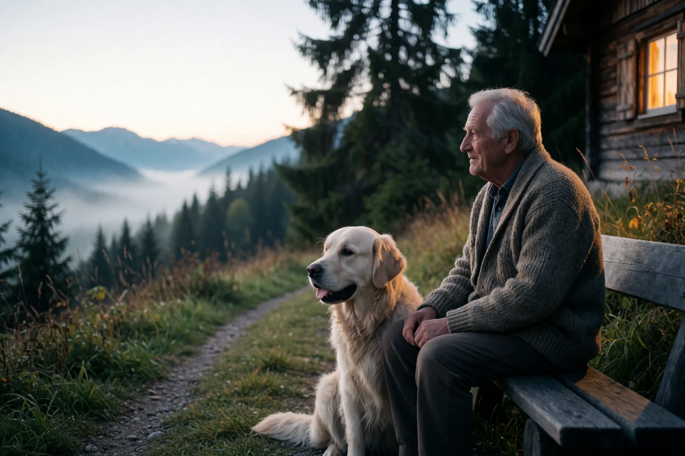
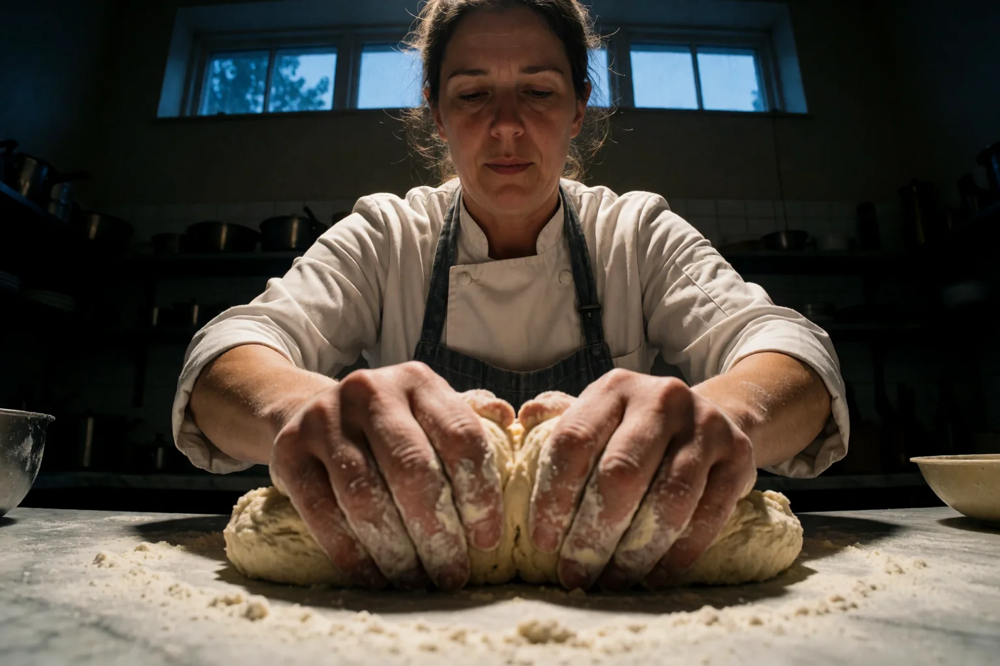
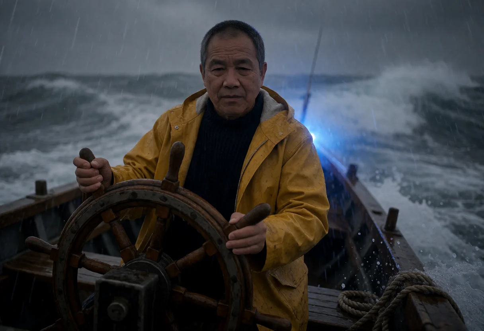
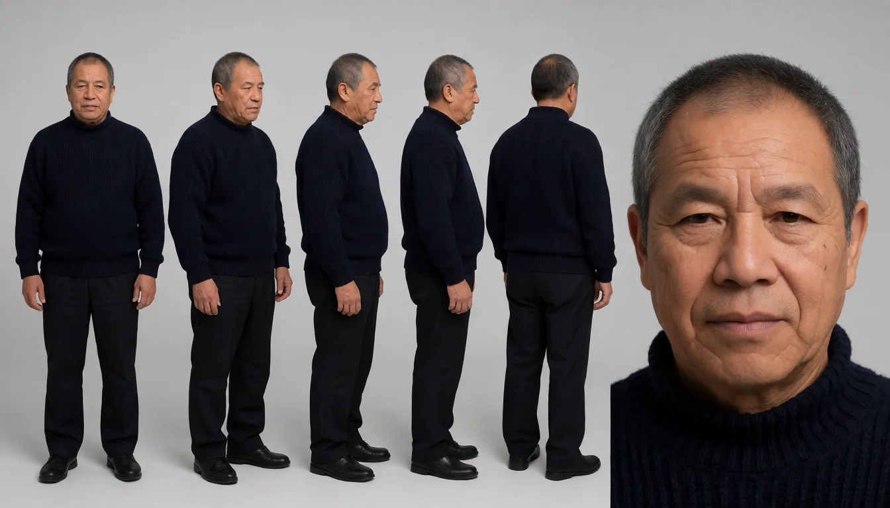

# ✦ Prompt Maker

**Say what you want to see, in plain words, and get pictures and videos made on your own computer.**
Start from an idea, a photo, or both. It writes for each model the way that model likes, keeps the same person from shot to shot and gives them a voice. Keep the ones you love, compare them side by side, find them again later. Twelve models are ready to go, more are on the way, and you can add your own. It's free, and it **runs on your own computer**: no account, no cloud, unless you add one.

**One man, four scenes, 22 seconds.** Made here, on one computer. [Watch it with sound](docs/renders/film-fisherman.mp4).

---

## Made with Prompt Maker

Every picture and clip below was made on one home computer with Prompt Maker, ComfyUI and free models. No retouching.

<table>
<tr>
<td></td>
<td></td>
<td></td>
</tr>
<tr>
<td></td>
<td></td>
<td></td>
</tr>
<tr>
<td></td>
<td></td>
<td></td>
</tr>
</table>

You don't write the long, technical prompts these models want. You type a few words and the **Brain** (an AI model, normally one running on your own computer) writes the prompt for you, in the way each model likes best.

## What you get

- **Pictures and videos from a few words, or from your own photo.** Choose a task from the icon row—make or edit a picture, keep the same person, animate a picture, copy movement, or make a video—then describe your idea. Hover or focus an icon for its full name. The app picks a suitable model and remembers your choices; its model menu stays folded unless you want to change that choice. Write up to four prompt variations, or make images and videos directly. Every detail you typed stays in the prompt: each take is checked against your idea, and what the Brain changed is put back.
- **The same person in every shot.** Drop in one picture of someone and they stay themselves in new places, new light, new scenes. See below.
- **Make it again from a file.** Drop in a picture or video made with ComfyUI, A1111, Forge or Civitai and **📜 Recipe inside** puts its prompt, model, LoRAs, seed and size back in one click.
- **Clips that carry on.** Turn any still into a video, then the next scene from the next still, and join them. The film above is four of these.
- **A voice for your character.** Describe a voice in plain words, hear it, keep it by name and have your character say a line in a video.
- **Your best work stays findable.** Library holds your artwork: rate it with stars, choose **Select → two pictures → Compare 2**, or pick any number and **⬇ Download** them in one .zip. **Saved prompts** holds the automatically saved prompts and sessions: bookmark the ones you want to reuse. **Hide from Create** tidies your workspace while keeping the artwork in Library.
- **A creative partner when you need one.** Open **Ask** for an Assistant that looks at your renders, helps you choose, plans a task of several steps and ticks it off, can run a batch, and turns a script of scenes into a shot list you check on the Jobs page, then makes the stills, the clips and the film while you do other things. It starts closed and remembers your preference. On small screens, **Create / Results** keeps your work one click away, including beside Ask on a laptop.
- **Several pictures at once.** A workflow that takes more than one picture (a person and a place with Krea 2 Character, pictures to combine with Qwen Image Edit, two views of the same person for MiniMax H3 Reference) gives **Add an image** a named slot per picture.
- **Runs on your own computer.** No account, no telemetry. It talks only to your own LM Studio and ComfyUI, so your client's unreleased work stays on your machine. The one exception is a Cloud Brain you add yourself, with your own key, and it asks before using it.

## What's new

**1.72.6 — the real GNOME title bar.** On GNOME (Ubuntu's desktop), 1.72.5 changed nothing: GNOME never lets a Wayland window ask for the desktop's title bar, so Chrome kept drawing its own 23-pixel bar with shrunken buttons. Prompt Maker's window now opens through XWayland on GNOME, and GNOME draws the title bar itself: the normal height and full-sized minimize, maximize and close. Graphics acceleration is the same either way; `PM_WAYLAND=1` opens a native Wayland window instead.

**1.72.5 — normal window controls.** On Linux, Prompt Maker now uses the desktop's normal title bar and borders instead of Chrome's compressed app frame. Minimize, maximize and close are full-sized again. This changes only Prompt Maker's private browser profile, not your regular Chrome windows.

**1.72.4 — a crisp title-bar icon.** The tiny icon beside “Prompt Maker · Create” now has its own 16-pixel artwork instead of shrinking a larger desktop icon into that space.

**1.72.3 — launcher icon refresh.** Prompt Maker now refreshes its window and sidebar artwork instead of reusing an old browser-profile copy, and a window opened from the desktop shortcut stays grouped under Prompt Maker's green icon in the system dock or sidebar.

**1.72.2 — Hugging Face tokens stay put.** **⬇ Model files → Connect Hugging Face** now has two short steps, a direct **Get a Read token** link, and a **Show** button. A pasted token no longer vanishes when the model list refreshes in the background; if Hugging Face rejects it, the token stays selected so the next paste replaces it.

[See the clearer Hugging Face connection](docs/screenshots/hugging-face.png).

**1.72.1 — the right icon everywhere.** Prompt Maker now uses a crisp small icon in its window and browser tab, and corrected app-icon sizes in the desktop, dock and window switcher. New Linux and Windows setups also put a launch shortcut on the desktop. **Settings → Services → Put a Prompt Maker shortcut on my desktop** adds or removes it in one click.

[See the desktop shortcut setting](docs/screenshots/desktop-shortcut.png).

**1.72 — set up everything from the app, on Linux too.** When LM Studio isn't on the computer, the banner, Settings → Services and the Brains page offer **⬇ Set up LM Studio**: on Linux it installs LM Studio's headless service (no window, nothing else touched; the desktop app can be added later), starts its server and fetches a Brain that can see (Qwen3-VL), each with a bar. A new **⬇ Model files** list (Settings → Services, the Models page, the end of the ComfyUI set-up) shows the big files each model needs in ComfyUI, in plain words (the model, its text encoder, its VAE, a LoRA), ✓ for the ones you have, the size of the rest, and **⬇ Get** for one, for a model, or for everything; a file behind a Hugging Face account (FLUX 3 Klein's) downloads too, once you connect your account with a token. **⬇ Set up ffmpeg** (Settings → Services, or under a motion video that needs it) fetches the video tools into the data folder, for phone videos, cutting and joining clips, and a voice on a video.

**1.70 — render settings for selected takes.** Above Prompt takes, expand **Render selected takes** and click the take numbers to select or deselect them. All start selected. Change size, seed, sampler settings, LoRA switches and strengths, or renders per take together, even when the takes have different settings. Each edit changes only that setting on the selected takes. **Render selected** uses their resulting settings; **Same as Fine-tune → Rendering** resets their custom settings. The panel starts collapsed. The workflow picker also affects only selected takes; if they use different workflows, choose a shared workflow before editing their detailed settings.

[See the shared render panel](docs/screenshots/shared-render.png).

**1.68.0 — 🎲 Surprise me looks at your picture.** With a picture in, the Brain looks at it and at the look you picked and suggests one idea that fits: what happens next when you animate a first frame, a new scene for the person you keep, where and from what angle for a motion video. Words you typed stay in and the idea is built around them, and each click gives something new. The picture is only looked at, never kept.

**1.67.0 — Windows, one installer.** `prompt-maker-<version>-setup.exe` installs Prompt Maker for your user with its own Node.js, and the first start gets everything else from one screen with progress bars: ComfyUI in its own folder with its own Python and the PyTorch for your graphics card (NVIDIA, Intel Arc, or the processor), LM Studio through its own installer, and a Brain that can see (Qwen3-VL). Settings → ⬆ Updates updates an installed copy in one click. Tried on one Windows 11 PC; the installer isn't signed, so Windows asks once (More info → Run anyway).

**1.66.4** replaces Create's task menu with a compact row of labeled icons. Each icon has a full tooltip and accessible name; picking one still chooses the remembered suitable model. The model menu now stays folded beneath the task row until you want it.

**1.69 — your own prompt sets.** In **Settings → Instructions → Your prompt sets**, give each category a name (for example, **ABC Branding Language**) and add example prompts separated by blank lines. Create as many sets as you need; edit or remove them there and click **Save settings**. In **Create → Prompt options** (or **Fine-tune → Writing**), check any combination to guide writing across all models; the take says "Writing with your … examples" while the Brain writes. Selections save immediately and survive a restart. Sets start unchecked and stay on this computer. Word-for-word prompts bypass them. Large requests may omit examples to fit the Brain’s available room.

[See the prompt-set editor](docs/screenshots/prompt-sets.png).

**1.64 — a shorter path from idea to result.** Create keeps task, idea, shape, size and takes together, with a wider workspace and a compact header. **Fine-tune** opens a roomy dialog: **Rendering** for workflow, sampler, seed and LoRAs; **Look** for camera and light; **Writing** for prompt length and creativity. LoRAs have readable rows instead of a long stack inside the setup column. **Shape** includes all supported ratios in one menu. **Prompt options** holds the word-for-word switch and your prompt-set checkboxes.

[See the wider rendering controls](docs/screenshots/fine-tune.png) · [Redesign work log](docs/ux-redesign-log.md).

**1.63.5** rates Brains with faces, 😞 Poor, 😐 OK, 🙂 Good, 🤩 Wow, right on each row of the Brain menu as well as on the Brains page and in the render viewer; Poor is a rating of its own, apart from the Brains you haven't tried. **1.63.3** makes the Brain picker easier to scan: each Brain is a full-width selection row with a clear check, provider and capability details are separated from its name, filters use one consistent style, and sorting is a familiar menu with a plain direction button. **1.63** folds Create's optional inputs away, brings **Takes** back, lets you rate Brains and sort or filter them by rating and thinking, and adds **Batches → Cycle settings** to vary seeds, samplers, size, duration and LoRAs in one go, up to 50 outputs. Local Brains, rendering and speech now take turns on the GPU instead of piling up. **1.59** brought the studio layout and the Sage, Sand, Ocean and Midnight themes. The full notes are in [What's new](docs/whats-new.md).

## The same person, every shot

One picture of a man on a dock. Prompt Maker writes down who he is, then every new picture and video keeps him: the same face, the same sweater, in a bar, in a storm, walking home.

<table>
<tr>
<td></td>
<td></td>
<td></td>
</tr>
</table>

One click on **🪪 Turnaround** gives you the same person from every side, so later shots hold up from any angle.

## From a picture to a video

<table>
<tr>
<td></td>
<td></td>
<td></td>
</tr>
<tr>
<td align="center">A still comes to life</td>
<td align="center">A character speaks (his line is part of the clip)</td>
<td align="center">Moves copied from any video</td>
</tr>
</table>

These are short previews without sound; click one to watch the video (the first two have sound). Wan Animate 2 makes your character perform the moves of any video you give it; the clip above follows a ten-second silhouette video from start to end.

## Get it

**1. Prompt Maker**

- **Ubuntu or Debian, one click:** download `prompt-maker_<version>_amd64.deb` from the [releases page](https://github.com/VincentAZ/prompt-maker/releases) and double-click it. It brings its own Node.js and puts **Prompt Maker** in your app menu and on your desktop.
- **Windows, one installer:** download `prompt-maker-<version>-setup.exe` from the same page (the newest release that has one: the Windows installer comes out less often than the Linux package) and run it. It installs for your user alone (no administrator password), brings its own Node.js, puts **Prompt Maker** in your Start menu and on your desktop, and opens it as its own window; the first start then gets steps 2 and 3 below by itself (ComfyUI with its own Python and PyTorch for your card, LM Studio, and a Brain that can see), each with a progress bar, so there's nothing else to install.
- **Any other computer:** install [Node.js](https://nodejs.org) 20.11 or newer, then `git clone https://github.com/VincentAZ/prompt-maker.git`, go into the folder and run `npm start`. Details for each system are in the [guide](docs/guide.md#installation).
- **Staying current:** **Settings → ⬆ Updates** checks GitHub when you ask, gets the newer version and restarts the app, for the .deb, the Windows installer and a git copy alike.

**2. LM Studio** (free, it runs the Brain). On Linux and Windows, Prompt Maker installs it for you: when it isn't there, the banner and **Settings → Services** offer **⬇ Set up LM Studio**, which also fetches a Brain that can see (Qwen3-VL); on Windows the first start does all that by itself. On macOS, install [LM Studio](https://lmstudio.ai), download a model, and Prompt Maker finds it. A vision model (marked 👁) lets you use your own pictures.

**3. ComfyUI** (free, it makes the pictures and videos). On Windows the first start installs it; on Linux, open **Settings → Services → ⬇ Set up ComfyUI** and Prompt Maker checks your graphics card, downloads and installs it, and starts it. Then **⬇ Model files** lists the big files each model needs and gets them for you. On macOS install [ComfyUI](https://github.com/comfyanonymous/ComfyUI) yourself; Prompt Maker hooks into it. Without ComfyUI you still get the prompts to use anywhere.

Once the app and your models are installed you can unplug the internet and keep creating with LM Studio and ComfyUI. Only downloads, update checks and a Cloud Brain you added yourself go online, and only when you ask. Every render keeps the recipe ComfyUI writes into it (prompt, model, seed, settings), so a file you share can be made again by anyone with the models.

You need a computer with a good graphics card. Linux is where it's tested every day. The Windows installer and launcher have been tried on one Windows 11 PC so far; if something doesn't work there, please tell us.

Twelve models are ready: **Krea 2 RAW** (text to image, image to image, and a Character version that keeps the same person), **Z-Image Turbo**, **Qwen Image Edit**, **LTX 2.3** and **MiniMax H3** (each one model that animates your picture and one that makes the video from words alone, and MiniMax with a Reference version for your person), **Wan Animate 2**, and **FLUX 3 Klein Base** (INT8 ConvRot, BF16, or NVFP4 text-to-image workflows). [Add your own](docs/guide.md#adding-or-updating-a-model).

## More

**[The full guide](docs/guide.md)** covers every page, setting and trick: Create, Voices, the Assistant, rendering with ComfyUI, chains, the Library, choosing a Brain, your data, troubleshooting and development.

**Under the hood**, for the technically minded: the assistant is a local-first agent harness. The Brain (a language model running in LM Studio on your computer) doesn't compose the steps of a job; it fills in a fixed shot-list shape, and the app checks every slot against your words and sends the list back to be fixed, compiles it into deterministic steps, shows it for your approval, runs it as a durable job that survives a reload and resumes, and asks a Brain to judge the renders where you asked for the best one. Its tests run the whole path against a scripted Brain and a mock ComfyUI. More in the guide: [the assistant](docs/guide.md#-the-assistant) and [development](docs/guide.md#development).

## Contributing

Issues and pull requests are welcome. The most valuable contributions are **model playbooks**: if you've dialed in prompting for a model, export its `.json` and share it. A workflow that ships in `workflows/` must carry nobody's data: empty prompts (positive and negative), seed 0, `example.png` as its picture, only ComfyUI's own nodes where possible, and a Hugging Face link for every model file (the test suite checks this). Please keep the app dependency-free and preserve fully offline use with local models, and run `npm run test:ui` before opening a PR. Contributions are accepted under the project's [license](#license). More in the [guide](docs/guide.md#development).

## Acknowledgements

- [LM Studio](https://lmstudio.ai), for making local AI models easy.
- [ComfyUI](https://github.com/comfyanonymous/ComfyUI), for being the best local rendering engine there is.
- The prompting guides from **Krea**, **Tongyi-MAI (Z-Image)**, **Qwen (Alibaba)**, **Lightricks (LTX)**, **MiniMax** and **Wan-AI** that the bundled playbooks are built on (sources are in each model's editor).
- Fonts: Ubuntu Sans under the Ubuntu Font Licence (`public/fonts/ubuntu-font-license.txt`); [Bricolage Grotesque](https://github.com/ateliertriay/bricolage) and [JetBrains Mono](https://github.com/JetBrains/JetBrainsMono), both under the SIL Open Font License (`public/fonts/OFL.txt`).
- The silhouette motion video behind the Wan Animate 2 clip is from [Pixabay](https://pixabay.com).

## License

[Functional Source License 1.1, Apache 2.0 future license](LICENSE) (FSL-1.1-ALv2) © 2026 Serpico Enterprises LLC. Ubuntu Sans uses the Ubuntu Font Licence (`public/fonts/ubuntu-font-license.txt`); the other bundled fonts use the SIL Open Font License (`public/fonts/OFL.txt`).

In plain words: use it, change it and share it for anything, including paid work made with it (your images and videos are yours). What you can't do is sell Prompt Maker, or a copy of it under another name, as a competing product or service. Two years after each version comes out, that version also becomes Apache 2.0, with no limits.

Versions up to and including 1.21.0 were released under the MIT license and stay MIT.
