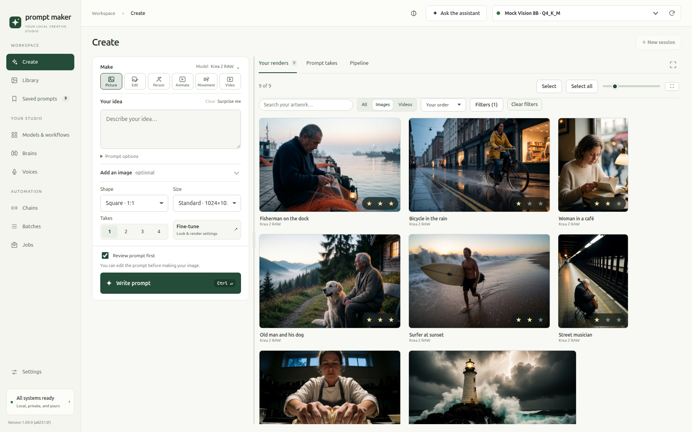
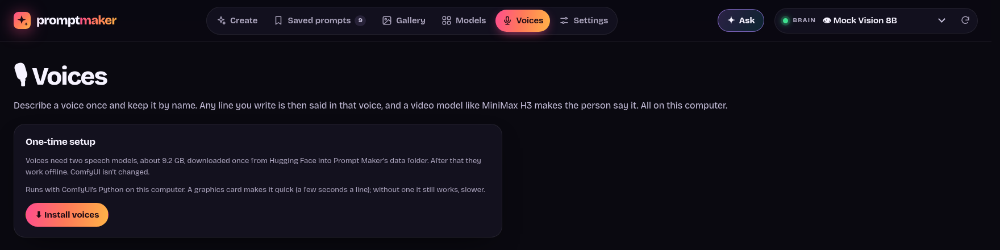
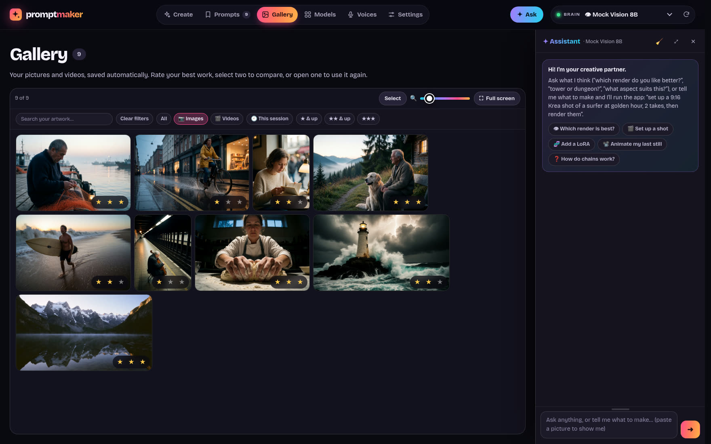
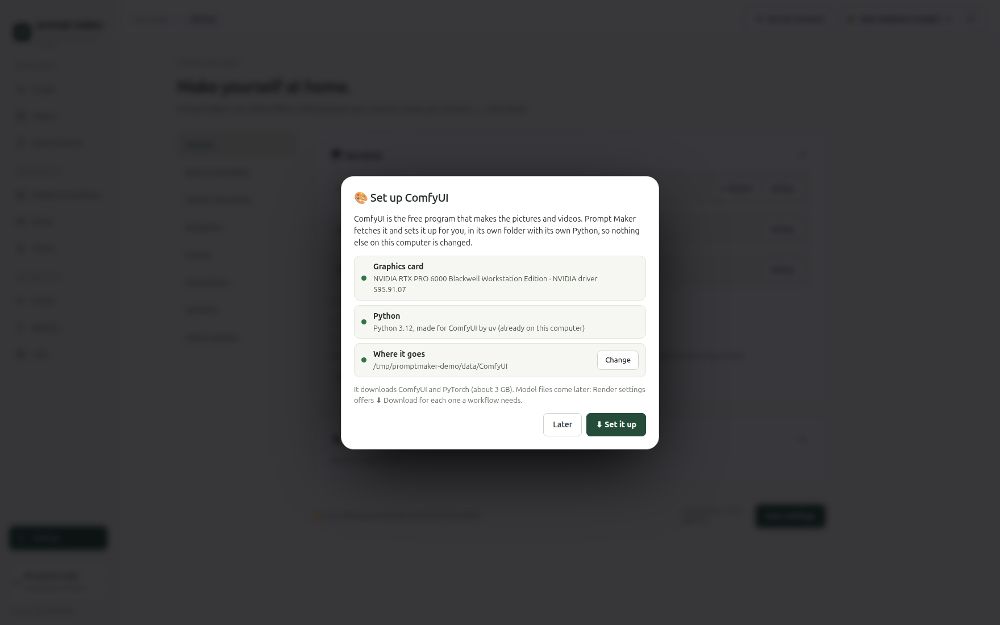
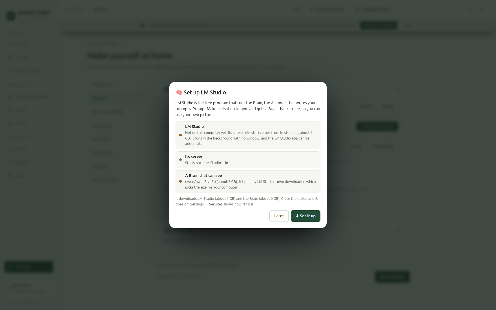
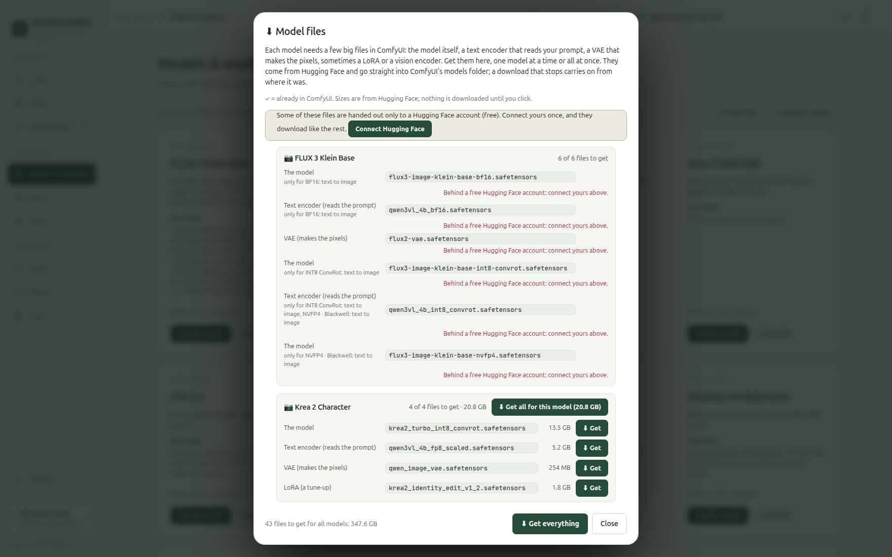
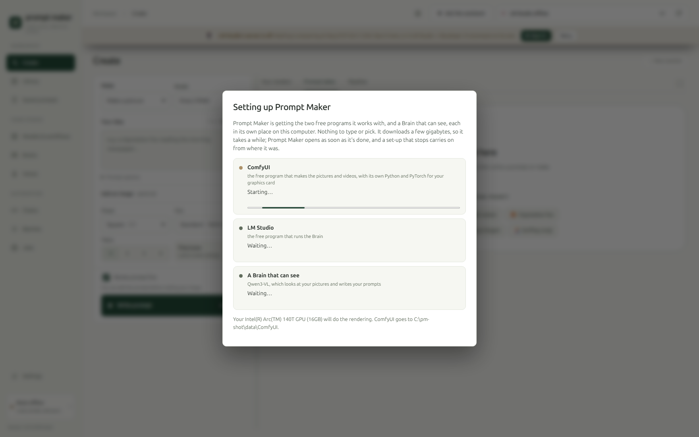
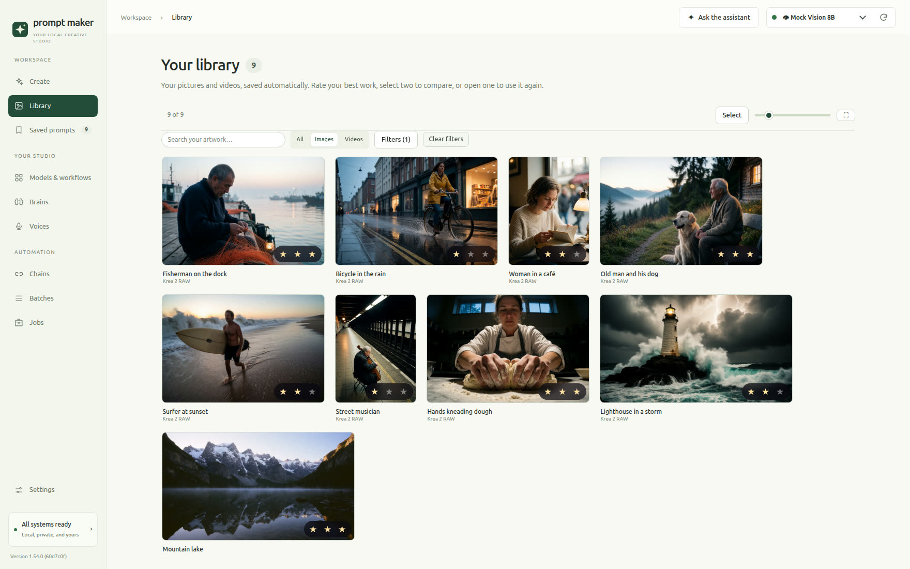
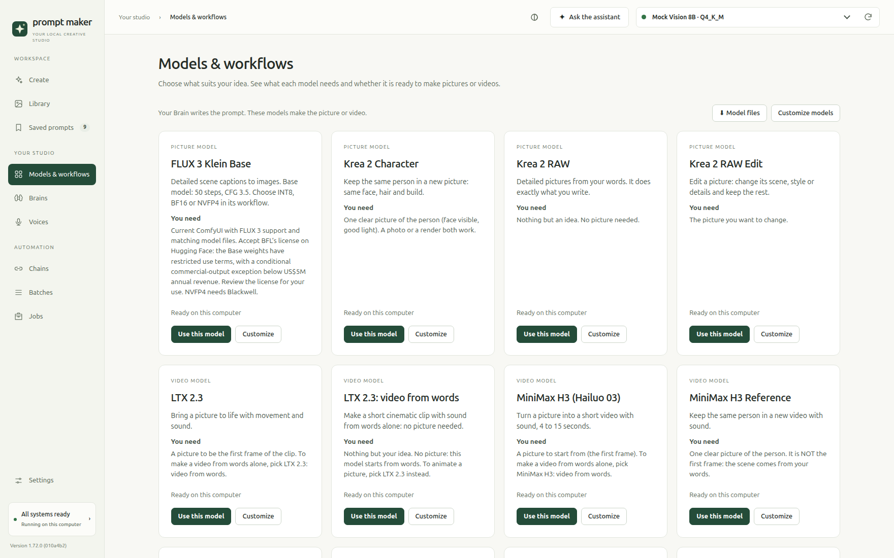
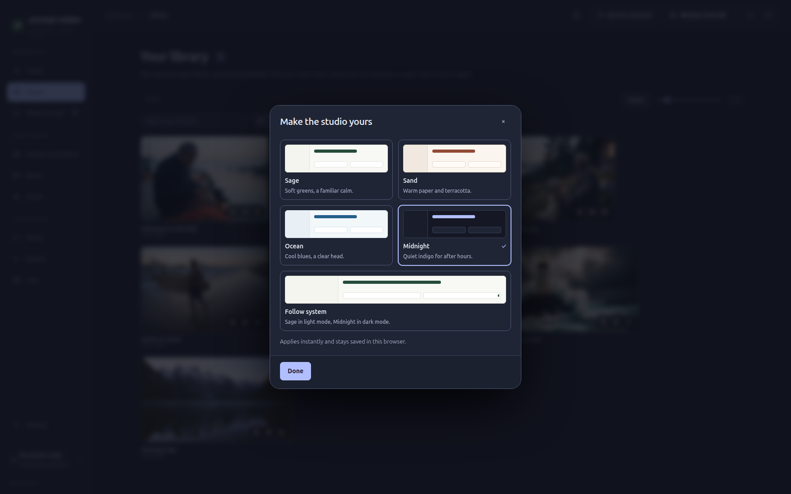

# Prompt Maker guide

The full manual for [Prompt Maker](../README.md): every page, setting and trick. The README has the short version.

## Contents

- [Features](#features)
- [How it works](#how-it-works)
- [Requirements](#requirements)
- [Installation](#installation)
- [Quick start](#quick-start)
- [Using Prompt Maker](#using-prompt-maker)
- [Rendering with ComfyUI (optional)](#rendering-with-comfyui-optional)
- [Target models](#target-models)
- [Choosing a Brain](#choosing-a-brain)
- [Settings](#settings)
- [Offline](#offline)
- [Your data](#your-data)
- [Troubleshooting](#troubleshooting)
- [Platform support](#platform-support)
- [Development](#development)
- [Contributing](../README.md#contributing)
- [Acknowledgements](../README.md#acknowledgements)
- [License](../README.md#license)

## Features

- **Theme → prompt.** Type an idea ("a woman at the beach with a soda in her hand"), pick a model, and get a finished prompt.
- **Image → prompt.** Drop in an image and use it three ways:
  - 🎯 **Reference**: borrow its look and blend it with your theme.
  - 🪞 **Recreate**: describe it so the model can reproduce it.
  - 🎬 **Animate**: video models only. The image is frame one, and the prompt describes what happens next.
- **Image alone.** Leave the theme empty and it suggests a prompt from the image.
- **✍️ Your own prompt (off by default).** Already have the prompt? Switch on **Use my own prompt, word for word** under **Your idea → Prompt options**: what you type or paste is sent to the model exactly as it is, with your image and your workflow. No Brain is asked, so LM Studio can even be off.
- **📜 Make it again from a file.** Drop in a picture or video made with ComfyUI, A1111, Forge or Civitai and, when it keeps how it was made, **📜 Recipe inside** puts it all back in one click: its prompt word for word, the model and workflow, its LoRAs at their strengths, the seed, size and length ([more](#make-it-again-from-a-picture-or-video)).
- **🧾 Same person, every render (Krea 2 Character, MiniMax H3 Reference).** Drop in a picture of someone and they stay themselves in brand-new pictures and clips: the Brain writes their **character sheet** once (face, eyes, hair, skin, build, marks), you can fix any line, and every take carries all of it. **🪪 Turnaround** renders them from every side and makes that the picture to follow. No denoise: the picture is the person, not a picture to repaint ([more](#same-person-every-render)).
- **🎙 Voices.** Describe a voice once ("a woman in her late twenties, warm light alto, soft Midwestern lilt"), hear it, keep it by name. Any line you write is then said in that voice, on this computer, and MiniMax H3 makes the person in your picture say it ([more](#voices)). One-click setup; ComfyUI isn't touched.
- **🕺 Character animation (Wan Animate 2).** Give it a character image and a motion video: your character performs the video's moves, in a setting and from a camera angle you describe. The Brain watches the video (a sheet of its frames) to name the motion, and ComfyUI's own Wan Animate 2 templates are one click away, set up for you. A model file your ComfyUI lacks is one **⬇ Download** away, and a video's black bars one **✂️ Crop** away.
- **Spell check where you write.** Your idea, the prompts in the takes, the Tweak it… boxes, the character sheet, looks, voice descriptions, the assistant's message box and the Brain's instructions underline misspelled words; right-click one for suggestions. It uses your browser's own spell check, so it works offline and follows the browser's language (if nothing is underlined, turn spell check on in the browser's settings).
- **Model-aware settings.** Shape, size, duration (video) and prompt length. Size offers the model's own sizes for the shape plus a range from Small to Huge (about 0.5 to 4 megapixels). None of them fit? Pick **✎ Type your own size…**, enter a width and height and click **✓ Use**: Shape turns to the size's shape (1280×720 → 16:9; a size no preset fits gets its own, like 1000×700 → **10:7 ✎**), so the render and the prompt are never sideways. The size stays in that model's menu as "Your size: …" and stays picked, shape and all, even after a restart; picking it again from the menu brings its shape back, and picking another Shape moves to a size in that shape (a picture you add does the same: its shape rules, so a square picture on MiniMax takes 768p, not your 2:3 size). **✕ Forget** takes it out. The render comes out at the size you pick, even with a workflow that works out its own size from a shape (like Krea's Dual Resolution Selector): the size goes past that node, straight to its latent and final size, so that workflow's own upscale is not used.
  - Uploading an image **matches the aspect ratio to it** automatically.
  - Each model remembers your last choices.
- **🎥 Directed like a film shot.** Every prompt gets camera and light chosen for your theme's mood, not the same default every time: a shot size, a camera angle, a lens, the focus, a main light and a second one with where they come from, a contrast word ("low-key", "high contrast") and a composition ("leading lines", "frame within a frame"). Want a particular feel? One click on a **Look** under your theme: 🪟 Natural, 🕯️ Intimate, ⚡ Powerful, 🌫️ Lonely, 🫣 Suspense, 👻 Horror, 🕵️ Noir, ☁️ Dreamy, 📷 Gritty, 🏔️ Epic or 💎 Luxury (video models get a camera move to match). Name a camera or light in your theme and it's kept. With a picture to 🎬 animate, its framing and light stay, and only the camera's movement is chosen.
- **🚫 No look, or your own.** **No look** keeps the Brain's hands off the camera and light: only what your theme or image says. **＋ Your own look…** keeps a look you describe yourself (a name, what the camera and light do, the camera move on video) next to the built-in ones.
- **Every detail you typed stays.** The Brain is told to keep every fact of your idea (who and how many, colors, clothes, objects, place, time, weather, what happens, quoted words) and to add detail only where you said nothing. After each take, one short check puts back any detail it changed, and the take says so.
- **Takes.** Write 1–4 prompts at once. Each take deliberately goes a different way (angle, lighting, setting, moment).
- **⏳ Queue.** No waiting for one to finish: while a prompt is cooking, the main button turns into **＋ Line up another** (what's cooking shows just above it) and, like `Ctrl+Enter`, lines up the next one, as many as you like. Each keeps the setup it was queued with, and its renders go on in ComfyUI while the next prompt is written.
- **Refine.** Tell a take what to change ("golden hour", "add a dog", "shorter") or tap a quick chip, or type it once in **🔁 All takes** to change every take the same way. Every version is kept and you can page through them, and hand edits are saved as versions too.
- **Live output.** Text streams in as it's written.
  - Word count against the model's ideal length (✓ when it's on target).
  - Timing for each take, plus a status while the model loads or thinks.
  - Progress shown in the browser tab title.
- **✦ Assistant with 🗂 jobs.** A creative partner that sees your renders and runs the whole app, anything you can click, and takes long jobs that run on their own, judge as they go and leave a log to review (*"8 stills of her in a noir café, same seed; animate the best in MiniMax at 20, 17, 13 and 10 steps. I'll be back in a couple of hours."*). For a task of a few steps it writes a plan first and ticks it off on screen; when a chat gets long, its earlier steps fold into a short note, so the Brain doesn't run out of room.
- **Saved prompts.** Every prompt is saved automatically and grouped by day. You can search it, filter by model, bookmark favorites, and reopen any entry to keep refining.
- **Delete takes the whole card.** Deleting a card removes its prompts, picture, motion video, spoken line and renders, in Prompt Maker and in ComfyUI, with a few seconds to undo. See [Saved prompts](#saved-prompts).
- **🎨 Render with ComfyUI (optional).** Attach as many ComfyUI workflows as you like to each model, then hit **▶ Render** on any take:
  - Pick any workflow you've saved in ComfyUI. Prompt Maker reads it directly, with no "Export (API)" step, and works out where the prompt, image, size, duration and seed go.
  - **🎁 Every model comes with a workflow**, already attached: pick a model and **▶ Render** is there. A model file you don't have yet is one **⬇ Download** away. Prefer your own? Add it and it's the one used; the one that came with the app stays in the list until you delete it.
  - Watch live progress (and previews) right on the take.
  - **🎞 Your renders**, on its own tab beside the takes, holds every render you've made, newest first, with filters and a caption under each (the idea's first words and the model), so nothing gets lost below a long prompt. Drag the cards into your own order, pick several (Ctrl-click or drag a box) to download or delete them in one go, and make the box as tall as you like, or full screen.
  - Rate the good ones: **★ Pretty good**, **★★ Very good**, **★★★ Excellent**.
  - **⇆ Compare** two renders side by side and **Pin on the left** until the best is left.
  - **Hide from Create** tidies your workspace; the artwork stays in Library and Saved prompts. **Delete** waits 8 seconds with **↶ Undo**.
  - Browse every result in the **Library**: the same grid as 🎞 Your renders, as tall as the window, in the same order you dragged them into. View any of them in a full-screen lightbox.
  - Chain models: turn a still into the input image for a video model with one click.
- **🧠 Brain profiles.** **Brains** shows every LM Studio model: how it thinks, how fast it is here, and how its prompts did for each of your models. The Brain menu suggests the best ones for the model you're on, and a one-click **Quick check** tests a new model in about 20 seconds.
- **Your prompt sets.** In **Settings → Instructions**, create named sets with your own example prompts. Separate examples with blank lines and save. Select any combination in **Create → Prompt options** (the same list is in **Fine-tune → Writing**); while the Brain writes, the take says "Writing with your … examples", so you know they went along. They go ahead of the model's own examples, so a Brain short on room leaves the model's out before yours; selections are remembered and work with every model.
- **Model playbooks you own.** Add a new model, edit its instructions, or paste a model's official docs and let your Brain draft the playbook. Import and export models as `.json`.
- **Zero install fuss.** Plain Node.js with no dependencies: no `npm install`, no build step.
- **No terminal after the first start.** On Linux and Windows a launcher puts Prompt Maker in your app menu and on your desktop, and starts it with your computer. **Settings → Services** starts and stops LM Studio, ComfyUI and Prompt Maker itself, adds or removes the desktop shortcut, and sets up what isn't on the computer yet: **⬇ Set up LM Studio** (with a Brain that can see), **⬇ Set up ComfyUI**, and **⬇ Model files** for the big files each model needs.
- **Runs on your computer.** Your work stays on your machine unless you add a Cloud Brain (see [Offline](#offline)).

## How it works

```
 You (browser) ──▶ Prompt Maker (localhost:5317) ──▶ LM Studio (localhost:1234)
                    • the target model's playbook      • your Brain (a local AI model)
                    • your theme / image / settings    • writes the prompt, streamed back
                                   │
                                   └──(optional)──▶ ComfyUI (localhost:8188)
                                                     • your workflow, with the prompt dropped in
                                                     • renders the image/video on your GPU
```

Prompt Maker builds a request out of three parts and sends it to LM Studio: its shared master rules (with a camera-and-light guide to how a cinematographer picks the shot and the light), the target model's playbook and example prompts, and your theme, image and settings. The Brain's reply streams back into the page as your prompt. When you render, Prompt Maker makes a copy of the workflow you picked, puts the prompt (plus image, size, duration and a fresh seed) into it, and queues it on your ComfyUI. The result is saved alongside the take.

## Requirements

| What | Details |
|---|---|
| **Node.js 20.11+** | [nodejs.org](https://nodejs.org). Check with `node --version`. |
| **LM Studio** | [lmstudio.ai](https://lmstudio.ai), free for macOS (Apple Silicon), Windows and Linux. On Linux and Windows, Prompt Maker sets it up for you (see [Setting up LM Studio](#setting-up-lm-studio-and-a-brain-that-can-see)); on Windows the first start does. |
| **A Brain** (a local AI model) | Any chat model works. Use a **vision** model (tagged "Vision" in LM Studio) if you want to use images. See [Choosing a Brain](#choosing-a-brain). The LM Studio set-up fetches Qwen3-VL, which can see. |
| **Hardware** | Enough memory to run that model. A small 4–8B vision model needs roughly 4–8 GB of GPU VRAM or Mac unified memory. CPU-only works, just slowly. |
| **A modern browser** | Chrome/Edge 111+, Firefox 121+, Safari 16.2+ |
| **ComfyUI** *(optional)* | Only for rendering. Any recent [ComfyUI](https://github.com/comfyanonymous/ComfyUI) running locally (default port `8188`); on Linux, **Settings → Services → ⬇ Set up ComfyUI** installs it for you, and on Windows the first start does (see [Rendering](#rendering-with-comfyui-optional)); **⬇ Model files** then gets the model files. Node 22+ gives live progress; older Node versions poll instead. |

## Installation

**Ubuntu / Debian, one click:** download `prompt-maker_<version>_amd64.deb` from the [releases page](https://github.com/VincentAZ/prompt-maker/releases) and double-click it (or `sudo apt install ./prompt-maker_*.deb`). It brings its own Node.js, puts **Prompt Maker** in your app menu and on your desktop, and the first start sets up the rest and asks how private you want it. LM Studio, a Brain that can see and ComfyUI come next, each in one click from **Settings → Services** (or from the banner and from Create, which say when one is missing), and **⬇ Model files** gets the files each model needs; steps 1 to 4 below are for every other system. To build the package yourself: `packaging/deb/build.sh` (it fetches Node 22 and writes `dist/`).

**Windows, one installer:** download `prompt-maker-<version>-setup.exe` from the [releases page](https://github.com/VincentAZ/prompt-maker/releases) and run it (take the newest release that has one: the Windows installer comes out less often than the Linux package, and Prompt Maker updates itself from there). It installs for your user alone (no administrator password; under `%LOCALAPPDATA%\Programs\Prompt Maker`), brings its own Node.js, puts **Prompt Maker** in your Start menu and on your desktop, starts it with your computer and sets up the link the page's Start button uses; tick **Open Prompt Maker** at the end and it opens as its own window. Windows may say it doesn't recognise the installer (it isn't signed): **More info → Run anyway**. **The first start then gets everything else** from one screen, with nothing to type or pick: ComfyUI in its own folder with its own Python and the PyTorch for your graphics card, LM Studio through its own installer (quietly, for your user), and a Brain that can see (Qwen3-VL, about 6 GB) through LM Studio's own downloader; each part has a bar, and nothing behind the screen can be used until it's done (a few gigabytes, so some minutes). A set-up that stops (no internet, the laptop closed) carries on from where it was with **↻ Try again**. See [The first start on Windows](#the-first-start-on-windows-everything-in-one-go). Prompt Maker runs in the background with no window of its own: close the app window when you're done and it keeps running; **■ Stop** on the Prompt Maker row in **Settings → Services** stops it. Steps 1 to 4 below are for every other system. To build the installer yourself, on Windows: `packaging\windows\build.ps1` (needs Inno Setup 6, `winget install JRSoftware.InnoSetup`; it fetches Node 22 and writes `dist\`), and `packaging\windows\check.ps1` tries the result in a throwaway folder, update included (it skips the first-start set-up).

**Updating it:** **Settings → ⬆ Updates → Check for a newer version**, then **⬆ Update** and **↻ Restart**: no terminal, for the .deb, the Windows installer and a git copy alike (see [Settings](#settings)).

**Removing it:** `sudo apt remove prompt-maker` (or remove it in your software app, if it lists it). On Windows, **Settings → Apps → Prompt Maker → Uninstall**: it stops Prompt Maker and takes the Start menu, desktop, start-with-your-computer and Start-link entries out with it. Your pictures, videos, playbooks and settings stay in your data folder, and ComfyUI and LM Studio stay too. Prompt Maker's start-with-your-computer entry stays in your home folder on Linux, but it does nothing once the app is gone, and installing again brings it back as it was. To remove that and the desktop shortcut too, run `prompt-maker --uninstall` first. If you then run Prompt Maker from another folder, it notices that the start-up entry points at the removed copy and moves it to itself; **Settings → Services** also says when that entry opens another copy, with a **Use this copy** button.

### 1. Install Node.js

- **macOS / Windows:** download the LTS installer from [nodejs.org](https://nodejs.org).
- **Linux:** use your package manager, or [nvm](https://github.com/nvm-sh/nvm): `nvm install --lts`.

### 2. Install LM Studio and get a model

**On Linux and Windows, Prompt Maker can do this step for you:** when LM Studio isn't on the computer, the banner at the top, **Settings → Services** and the **Brains** page offer **⬇ Set up LM Studio**, which installs it, starts its server and fetches a Brain that can see (see [Setting up LM Studio](#setting-up-lm-studio-and-a-brain-that-can-see)). By hand:

1. Install [LM Studio](https://lmstudio.ai) and open it once. This also installs its `lms` command-line tool.
2. Go to the **Discover** tab (🔍) and download a vision model, for example **Qwen3-VL 8B**.
3. Turn on the local server. Any of these works:
   - In LM Studio: **Developer** tab → **Start server** (it runs on port `1234`).
   - In a terminal: `lms server start`
   - Or skip this step: Prompt Maker shows a **▶ Start it** button when the server is off.

> **Tip:** LM Studio loads a model automatically the first time it's used, so you don't have to load one by hand. The first prompt just takes a few extra seconds.

### 3. Get Prompt Maker

```bash
git clone https://github.com/VincentAZ/prompt-maker.git
cd prompt-maker
```

No git? Click **Code → Download ZIP** on GitHub and unzip it.

There's nothing to install. Prompt Maker has no dependencies.

### 4. Start it

```bash
npm start
```

Then open **http://127.0.0.1:5317** in your browser.

On **Linux** you can use the launcher instead. It starts LM Studio's server if needed, starts the app and opens your browser, and if the app is already running it just opens it:

```bash
./start.sh
```

To stop Prompt Maker, press `Ctrl+C` in the terminal.

**On Linux, the first start sets everything up for you,** so you never need the terminal again:

- **Prompt Maker in your app menu and on your desktop.** Open either launcher like any other app. It comes with its own icon (the green star), which the app menu, desktop, dock, window switcher and share-screen dialog all show for the Prompt Maker window. **Settings → Services** can add or remove the desktop shortcut later.
- **It starts with your computer** and keeps running in the background. It turns on LM Studio's server too, and comes back on its own if it ever stops. Switch this off or on in **Settings → Services**.
- **A Start button that works even when Prompt Maker is off.** If the page ever says *Prompt Maker's server isn't running*, click **▶ Start Prompt Maker**. The first time, your browser asks to open Prompt Maker: allow it (tick *Always allow*). The page keeps a copy of itself, so it opens even while the server is off.

**Start and stop everything from Settings → Services,** with no terminal:

| Row | What you can do |
|---|---|
| **Prompt Maker** | ■ Stop it. The page shows it stopped right away (the rows say *Stopped*) and offers ▶ Start Prompt Maker |
| **LM Studio** | ▶ Start its server, or ■ Stop it, which first unloads every model to free the GPU. Not on this computer yet? **⬇ Set up LM Studio** installs it, with a Brain that can see (see [Setting up LM Studio](#setting-up-lm-studio-and-a-brain-that-can-see)) |
| **ComfyUI** | ▶ Start it, or ■ Stop it. It starts from its folder, the way Prompt Maker last saw you run it, or with live previews on (`--preview-method auto`); change the folder or the options under **ComfyUI** in Settings. Tick *Start ComfyUI along with it* to have it come up with Prompt Maker. Not on this computer yet? **⬇ Set up ComfyUI** installs it (see [Setting up ComfyUI](#setting-up-comfyui-one-click)). **⬇ Model files** lists the big files each model needs and gets the ones that aren't here (see [Getting the model files](#getting-the-model-files--model-files)) |
| **Video tools (ffmpeg)** | Says whether ffmpeg is on this computer (its own copy in the data folder, or the system's). Not there? **⬇ Set up ffmpeg** fetches a ready-made build (see [Setting up ffmpeg](#setting-up-ffmpeg-video-tools)) |

**■ Stop everything (frees the GPU)** stops ComfyUI, unloads LM Studio's models and turns its server off, then stops Prompt Maker. On Create, *ComfyUI offline* has a **▶ Start it** link too.

If the app folder moves or is removed, the start-up entry does nothing instead of failing at every login, and the next start from the new place moves it there. To undo all of it, run `./start.sh --uninstall`; `./start.sh --install` sets it up again. Logs: `journalctl --user -u prompt-maker -f`; ComfyUI's own output, when Prompt Maker starts it, goes to `comfyui.log` in your data folder, not the system journal. The launcher opens Prompt Maker as its own app window with its own browser profile in the data folder (Brave, Chromium, Chrome or Edge, whichever is there; the default browser otherwise). `PM_BROWSER=/path/to/browser` picks the browser, `PM_BROWSER=default` keeps the old way. macOS gets the same setup with its own launcher (coming).

On **Windows**, the installer does all of this as it installs (see [Installation](#installation)); with a git copy, double-click **`start.bat`** in the app folder. It starts LM Studio's server if needed, starts Prompt Maker in the background (no window of its own) and opens it as its own app window with its own browser profile in the data folder, as on Linux (Brave, Chrome, Chromium or Edge, whichever is there, so always a window; `PM_BROWSER` as above). The first start also puts **Prompt Maker** in your Start menu and on your desktop, and makes it start with your computer; **Settings → Services** controls both start-up and the desktop shortcut, and `start.bat --uninstall` removes them. Closing the window leaves Prompt Maker running; **■ Stop** in Settings → Services stops it. To see what the server prints, run `node server.js` in the app folder instead. Tried on one Windows 11 PC so far: if something doesn't work, please report it.

## Quick start

1. **Pick a brain.** Use the **Brain** menu at the top right: models marked 👁 can see images, and "loaded" means it's ready right now.
2. **Choose what to make**, for example **Make a picture**. The task picks a suitable model; **Target model** lets you choose another.
3. **Describe the shot.** Type a theme, or hit **🎲 Surprise me**. With a picture in your inputs, Surprise me has the Brain look at it first, and at the look you picked, and suggests an idea that fits them: what happens from that first frame when you animate it, a new scene for the person you keep, an idea that grows out of a reference. Words you typed (*playful woman*) stay in and the idea is built around them; each click gives a different one. While it looks, the button turns into **■ Stop** and the step's title line says *Looking at your picture…*; a click on Stop stops it. It needs a Brain that sees images (👁); without a picture, or with a text-only Brain, the idea comes from a list as before (what happens, when you animate). **✕ Clear** empties the box in one click (**↶ Undo** brings it back, after a surprise too).
4. Click **Write prompt**, or turn off **Review prompt first** to **Make image** or **Make video** with your configured workflow. `Ctrl+Enter` runs the same action. Existing auto-render preferences are preserved.
5. **Copy** the prompt, or tweak it: type *"make it night time"* in the box under the take and press Enter.

## Using Prompt Maker

The sidebar has Workspace (**Create**, **Library**, **Saved prompts**), Your studio (**Models & workflows**, **Brains**, **Voices**), Automation (**Chains**, **Batches**, **Jobs**), and **Settings**. On a phone, open the navigation button in the top bar. Existing `#gallery`, `#history`, and `#models/brains` links still work.

### Create



| Step | What it does |
|---|---|
| **Make** | Choose a creative task. Its recommended model appears in **Model**; use that menu to change it. The app remembers your preference. **Animate a picture** and **Make a video** are different models: the first starts from your picture (LTX 2.3, MiniMax H3), the second from your words alone (**LTX 2.3: video from words**, **MiniMax H3: video from words**). **Fine-tune → Rendering → About this model** starts folded and offers the practical guide and example ideas when you want them. |
| **Your idea** | Your theme: short or long, casual is fine. Optional if you add an image. **Fine-tune → Look** sets how the camera and light feel: one of eleven, **No look**, or **your own** (see below). Have the exact prompt already? **Prompt options → Use my own prompt, word for word** sends it as it is, with no Brain (the Look steps aside). Under it, select any of your named prompt sets to guide the Brain. |
| **Add an image** | Drop, paste (`Ctrl+V`) or browse. A picture that keeps how it was made shows **📜 Recipe inside** (see [Make it again from a picture or video](#make-it-again-from-a-picture-or-video)). **More than one picture:** when the workflow picked in Fine-tune → Rendering takes several (a person and a place, pictures to combine), Add an image grows a slot per picture under the first, each named by the workflow (**Person**, **Another picture**…) and marked *needed* or *optional*: ＋ Add, Library, Replace, Remove, or drop a picture straight onto the slot. The Brain sees every picture and is told which is which; the render uploads them all, and an optional slot left empty is simply left out of the workflow. On a model that works from words alone (the **video from words** ones) this step is greyed out and says **No image**: nothing can be dropped, and a picture you already added is set aside, not sent, until you pick a model that takes one. Otherwise:  Click the image to see it full screen (click again for actual size). Picking from your Library? Each picture shows its stars, so a good one is easy to spot; drag the 🔍 slider for bigger thumbnails, or hit a tile's 🔍 to look closer. Then choose how to use it (below). On a character-animation model (Wan Animate 2) this step is **Character & motion**: the image is your character, and a **🕺 motion video** goes under it (see [Character animation](#character-animation-wan-animate-2)). |
| **Output choices** | Choose **Shape** from one menu with every supported ratio, then pick the size, video duration and number of takes. **Size** lists sizes in the picked shape, from Small (about half a megapixel) through Standard, Large and Extra large to Huge (about four), with HD, Full HD, 2K and 4K by name; it starts on the model's usual size and follows the shape. **✎ Type your own size…** at the bottom takes any width × height; **✓ Use** keeps it in that model's Size menu (the last twelve, in your data folder, so after a reboot and in any browser too). Pick it and **✕ Forget** takes it out. Your choices (shape, size, duration, and in Fine-tune → Writing prompt length and how imaginative) are kept per model in the data folder too, so the app window, a browser tab and every restart open on what you picked last. |
| **Fine-tune** | A wider dialog keeps detailed choices out of the setup column. **Rendering** holds workflow, sampler, seed, LoRAs, auto-render, renders per take and batches. **Look** sets camera and light. **Writing** sets prompt length and creativity, with a link to Chains. Changes are kept as you make them; **Done** or Escape returns to your creation. |

**The results have three tabs**, beside the form: **Your renders** (every picture and video, in one grid that fills the rest of the window), **Prompt takes** (what the Brain wrote, with its buttons), and **Pipeline** (your chain’s steps and continuation controls). The tabs stay in place while the results below them scroll. One shows at a time, so switching between them keeps the workspace steady. Before you write anything, the takes tab explains the next step and offers ideas to try. Pressing the main button (or opening a saved prompt) shows the takes. A render landing never switches the tab by itself: the Your renders tab gets a dot instead, and you look when you're ready. On a wide window the renders grid fills the stage; on a narrow one the box has a bottom edge to drag. **Drag the divider** between the form and the results to give either side more room (double-click it to reset; arrow keys work on it too). In the render viewer, drag the prompt box's lower-left corner to change its width and height. Both sizes are remembered in your browser.

**Review prompt first** beside the main action remembers your choice per model. The button states the outcome and total count, such as **Make 8 images** for four variations rendered twice. Progress shows **Writing prompt → Making image/video → Ready**. On narrow screens, including a laptop with Ask open, **Create / Results** switches directly between the form and current work. **Your renders**, **Prompt takes**, and **Pipeline** are separate result tabs. Queue status and errors stay visible across them. **Pipeline** shows the steps and choices for a chain and opens when the chain needs your next pick.

**＋ New session** beside the page heading clears the theme, image and takes but keeps your model and dials. **↶ Undo** brings it all back, and everything stays in Saved prompts.

**⏳ Queue: line up as many as you like.** While a prompt is cooking (or a batch is rendering), the main button turns into **＋ Line up another**, with what's cooking (**✦ Writing prompt…**, a batch's progress) on the line above it and how many are waiting under it; it (or `Ctrl+Enter`) puts the form, as it is right then, in line, the way ComfyUI queues renders:

- **What you see when you click is what runs.** Each one in line keeps its model, theme, image and role, dials, takes, batch, and render setup (workflow, auto-render, LoRAs and sampler settings). Change the form afterwards to set up the next one; it won't touch those already waiting. (The Brain and the seed are the ones in use when its turn comes.)
- **They run in order**, each its own run and Saved prompts entry. A take's renders go on in ComfyUI while the next prompt is written; a batch finishes its renders before the next starts.
- **Up next**, at the top of the results, lists them: **✕** takes one out (with **↶ Undo**), **Clear** empties the line. Clicking twice on the same form within a second queues it once.
- **■ Stop** (or `Esc`) stops only the one running; the rest carry on. If one fails (LM Studio or ComfyUI went away, say), the line goes **⏸ on hold** so the rest don't fail the same way: fix it, then **▶ Carry on**.
- A chain (Fine-tune → Rendering, Then…) can't wait in line, since it may stop to ask you to pick. The line lives in the page: reloading it lets go of what's waiting (the page asks first).

**✍️ Your own prompt, word for word.** Off by default. When you already know exactly what to send, switch on **✍️ Use my own prompt, word for word**, under the box in Your idea. Then no Brain is involved at all:

- **Your idea Your prompt** is the prompt. What you type or paste goes to the model letter for letter: weights like `(red kite:1.3)`, odd spellings, all of it. It must not be empty.
- **Add an image Your image** goes into the workflow as it is: there's no Reference / Recreate / Animate to pick, since those tell the Brain what to write.
- **What would you like to make? Your model** and **Fine-tune → Rendering your workflow** are the ones that render it. Aspect, resolution and duration in Make it yours still set the size; prompt length and how imaginative step aside, and **Takes** becomes **Renders**: how many times your prompt is rendered (×1–4), each with its own seed.
- The main button becomes **Make image** or **Make video** and renders right away (auto-render isn't needed). No workflow for that model yet? It becomes **Keep my prompt**: the take is saved, ready to copy or render later.
- The take says *✍️ your own prompt, word for word*, and Saved prompts marks it the same way. Reopening one from Saved prompts switches the mode back on; reopening a Brain's prompt switches it off. You can still click **Refine** on the take if you do want the Brain's help with it (that refine isn't checked against your idea, which here is the old prompt: it would only put the old words back). Note that **Make image** always sends the text in Your prompt: a refined take is rendered with its own **▶ Render**.
- A batch renders your one prompt as many times as it says. A chain (Fine-tune → Rendering, Then…) is written by the Brain, so it's hidden while the switch is on, and waits for you, untouched, until you switch it off.
- LM Studio doesn't need to be running.

**Image modes**

| Mode | Use it when… | What the prompt does |
|---|---|---|
| 🎯 **Reference** | You like the image's vibe | Carries its subject, palette, lighting and mood into *your* theme. |
| 🪞 **Recreate** | You want *that* image | Describes it faithfully so the target model can reproduce it. Your theme becomes changes. |
| 🎬 **Animate** | Image-to-video (video models only) | Treats the image as the first frame and describes the motion, camera and sound from there. |
| 🧍 **Character** | Character animation (Wan Animate 2) | The generator gets the image as the character to animate. The prompt describes how it looks exactly as it is, and where it is. It's the only way those models use an image, so there's nothing to pick. |

**🎥 Look** (under the theme) is how the camera and the light feel: how close, from which angle, what kind of light. **✨ Brain picks** (the default) lets the Brain choose them for your theme's mood. Or pick one, and every take is built on it:

| Look | What you get |
|---|---|
| 🪟 **Natural** | Like a real photo: eye level, soft window light, the background softly blurred. |
| 🕯️ **Intimate** | Close and quiet: a tight shot, the background melting away, soft light from the side. |
| ⚡ **Powerful** | Larger than life: the camera looks up, strong light from behind outlines the subject. |
| 🌫️ **Lonely** | Small in a big world: a wide shot, lots of empty space, cool dim light. |
| 🫣 **Suspense** | Something's wrong: a tilted frame, half hidden, deep shadows. |
| 👻 **Horror** | Dread: dark, centered, flickering light, light from below. |
| 🕵️ **Noir** | An old detective film: black and white, hard light, blind-stripe shadows, smoke. |
| ☁️ **Dreamy** | Soft and glowing: hazy focus, warm light from behind, pastel colors. |
| 📷 **Gritty** | Raw and real: handheld, only the light that's there, every detail and flaw. |
| 🏔️ **Epic** | Huge and grand: very wide, everything sharp, hazy light from behind. |
| 💎 **Luxury** | A polished ad: studio light, gleaming highlights, perfect composition. |
| 🚫 **No look** | Nothing of the Brain's own: the camera and light are only what your theme or image says. |

On a video model the look also picks the camera's move (a slow push in for Intimate, handheld for Gritty, a drone reveal for Epic). Anything your theme says about the camera or light still wins. The look is remembered, saved with each prompt (Saved prompts shows it on the card), and the ✦ assistant can set it too.

**Your own look.** Click **＋ Your own look…** at the end of the row, give it a name (and an emoji if you like), say what the camera and light do ("a 35mm lens at eye level, neon signs as the only light, wet reflections") and, for video, what the camera does; **✓ Keep this look** adds it to the row, picked. **✎ Edit this look** and **🗑 Delete this look** under the row work on the picked one (↶ Undo for a few seconds). A take keeps the words of the look it was written with, so refining it works even after the look is edited or deleted; opening such a take from Saved prompts says so and goes back to Brain picks.

**Writing creativity** (in Fine-tune → Writing; the Brain's *temperature*, the number beside the slider) runs from 🎯 *precise* to 🌶️ *wild*. Lower values stick closely to your words, higher values get more inventive. Each model sets its own default.

**Prompt length** (in Fine-tune → Writing; *short / medium / long*) means something different for each model. For example, "medium" is about 70–120 words for Krea and about 160–260 for MiniMax. Every take shows its word count against that target.

**Every detail of your idea stays in the prompt.** The Brain is told to keep every fact you typed (who and how many, colors, clothes, objects, place, time, weather, what happens, quoted words) and to add detail only where you said nothing. After each take, one more short Brain call checks it against your idea; if a detail was changed or dropped, it is put back and the take says so under the text: *✓ Checked against your idea* or *✎ Put back: a red dress, two dogs*. Saved prompts shows the same on the card. A refine is checked too, but what you asked to change is never put back, even when the check names it: a detail that shares a word with your instruction ("both hands" and *his right hand*) stays as the refine wrote it. A refine of a ✍️ own-prompt take isn't checked at all: there, your idea *is* the old prompt, and checking against it would undo every change. Switch it off under **Settings → 🧠 How the Brain thinks** if you'd rather save a few seconds per take.

**Keep it tidy:** task, idea and output choices stay visible on Create. Optional image inputs, individual takes, and cards in Settings and Models can fold down to a summary; Prompt Maker remembers those choices. **Fine-tune** opens the detailed controls separately: **Rendering** for workflow, sampler, seed and LoRAs, **Look** for camera and light, **Writing** for prompt length and creativity. Settings groups technical controls by section. On a model's page, instructions, sizes, defaults and lengths start folded.

**Nothing jumps.** On a wide window the steps and your takes sit side by side and each scrolls on its own, so new takes and renders never move the steps. While a take is being written, its buttons are already there, greyed out, and so is the tile for its render when auto-render is on; nothing below moves when the take is done. Fold a step or a take and the header you clicked stays where it is: the space it freed sits at the end until you scroll back up. A render that lands takes the place of its own running tile, on the take and in Your renders alike (×4: four tiles from the start, each filled in as its render comes), so nothing slides over while a run renders. A running job's bar (from the assistant) sits above the takes. The box of a take is held at the height its prompt is expected to need from the first word (from the model's length target), its word count's row is there from the start, and a refine keeps the box at least as tall as it was, so nothing under a take moves while it's written or rewritten.

### Voices



The **🎙 Voices** page makes speech on this computer, so the same person can say every line of a video in the same voice.

- **One-time setup.** Click **⬇ Install voices**: Prompt Maker fetches two speech models ([Qwen3-TTS](https://huggingface.co/Qwen/Qwen3-TTS-12Hz-1.7B-Base), Apache 2.0, about 9 GB) into its data folder and sets up the few packages they need, beside ComfyUI's own Python. ComfyUI's packages aren't changed, so nothing there can break. After that, voices work offline. A graphics card makes a line take a few seconds; without one it still works, slower.
- **Describe a voice** in plain words (age, warmth, accent, pace, mood), give it a sentence, and **▶ Hear it**. Not it? Change the words and hear it again. Right? Name it and **💾 Keep this voice**. No real person is cloned: the voice is made from your description.
- **Your voices** are listed with their description. **▶ Sample** plays the sentence they were made with; type any line in **Try a line** and **🗣 Say it** on a voice to hear it. **✏** renames, **🗑** deletes (it asks once).
- **In a video** ([MiniMax H3](#target-models)): Add an image shows **🎙 Says a line**. If the picked workflow takes no line but one of the model's does (or the one that comes with the app), it offers **🎙 Use the one that does**: one click adds and picks it; the assistant's `set_line` does the same by itself. Then: pick the voice, write the line word for word. When you create, the line is said in that voice and the Brain writes the take around it; at **Render** the clip is the video's soundtrack, so the person in your picture says exactly those words, lips in time, and the video is made at least as long as the line (the line plus a second): once the take is written, **Duration** says so next to the dial when the line is longer than it (*→ 10.5 s, as long as the line*). Once rendered, the clip is cut to the line: a model may go on past the words (MiniMax H3 keeps the person talking, in made-up words), so whatever comes more than a third of a second after the last word is taken off, and a clip with a line ends when the line ends (the full-screen view says *Cut to the line*). The line is saved with the prompt (Saved prompts puts it back; the full-screen view shows *Says*). A take with no line renders as before: the sound nodes are simply left out.
- **The assistant does it too:** *"make a new voice called Sam: a deep, calm narrator"* (`make_voice`), *"make her say 'Hello there' in Sam's voice"* (`set_line`). In a job, a `set_line` step before `generate` gives each cut its line, so a whole promo can run overnight: stills, the pick, the line, the video, the judge.
- **Where it lives:** `voice/` in your data folder: the packages (`site/`), the models (`hf/`), your voices (`voices.json`) and their clips (`clips/`). Delete the folder to start over.

### Same person, every render

Two models keep the person in your picture instead of repainting the picture: **Krea 2 Character** (pictures) and **MiniMax H3 Reference** (video clips with sound, MiniMax's *ref2va*). Your picture only tells them *who*: the place, clothes, pose, camera and light come from your theme. There is no denoise to set.

- **🧾 Character sheet.** Pick one of the two models and add a picture in Add an image: a **Character sheet** box appears under it. When you create, your Brain (one that sees images 👁) looks at the picture and writes the person's traits, one per line: age, face, eyes, eyebrows, nose, lips, skin, hair, facial hair, build, height and marks (freckles, moles, tattoos). Then every take carries **all** of them, in the sheet's words; a trait the Brain leaves out is added back by the app. It's saved with the prompt in Saved prompts.
  - **Fix a line** by typing in the box (the Brain got the eye color wrong, say): the next prompt uses your sheet as it is.
  - **↻** writes a fresh one from the picture next time you create. A new picture starts a new sheet.
- **🪪 Turnaround** (Krea 2 Character): one click renders the person on a plain background from the front, three-quarter, side and back, with a close-up of the face, and when it's done it becomes your picture in Add an image (the sheet stays). From then on every render reproduces them from all sides, and a full-body turnaround also lets the sheet name their build and height. It uses the workflow that comes with the model (or yours) in Fine-tune → Rendering.
- **The workflows that come with these two models**:
  - **Krea 2 Character**: Krea 2 Turbo with the [Krea 2 Identity Edit](https://huggingface.co/conradlocke/krea2-identity-edit) LoRA, 10 steps, its likeness dial at 4. It needs the [comfyui-krea2edit](https://github.com/lbouaraba/comfyui-krea2edit) nodes (in ComfyUI: **Manager → Install Missing Custom Nodes**). The LoRA is under the Krea 2 Community License.
  - **MiniMax H3 Reference**: ComfyUI's own reference-to-video template, with one reference picture and 20 steps (its optional 4-step turbo LoRA left out, so nothing extra to download); only ComfyUI's own nodes.
- **Good to know:** the likeness holds best for faces whose identity is in their texture (freckles, marks, hair). Very unusual face shapes drift toward typical ones. A change of outfit sometimes lets a bit of the old one through: re-roll, or say the new outfit plainly in your theme.

### Character animation (Wan Animate 2)

[Wan Animate 2](https://github.com/Wan-Video/Wan-Animate-2) makes a **character image** perform the moves of a **motion video**: a dance, a walk, a fight scene. The character keeps its look from the image, the moves come from the video, and the **setting, light and camera angle come from your theme**. Pick **Wan Animate 2** in What would you like to make? and Add an image becomes **Character & motion**:

- **🧍 Character:** drop, paste or pick an image, like any image. A clear, full shot of one character works best.
- **🕺 Motion video:** drop a video on the page, **browse**, or **🎞️ Pick a video from your Library** (any video you rendered). MP4, WebM, MOV and MKV work, up to 500 MB. It plays in Add an image.
  - **The clip takes your character's shape**, as in Wan-AI's own code: **Aspect** (Make it yours) follows the character image, and ComfyUI crops the motion video to it at the center. (Until you add a character, Aspect follows the video.) When the two differ a lot, Add an image says which sides of the video get cropped: keep the moves near the middle, or use a character image in the video's shape.
  - Frame it like your character: full body to full body. A close-up character with a full-body dance (or the other way round) is the most common cause of a bad result.
  - **⬛ Black bars** (a webcam or screen recording inside a wider frame, a letterboxed film) would count as part of the video. Add an image spots them and offers **✂️ Crop the bars**: a copy with just the picture, sound kept.
  - **✂️ Trim** (under the video) uses just part of a long video, cut to the frame, in a big window of its own:
    - **The frame at the playhead** fills the window, with its time and number below it (*0:05.92 · frame 72 of 1159*).
    - **The timeline** is a strip of the video's frames. Press and drag anywhere to move the playhead. The part you keep is lit between two handles, and the rest is dimmed: drag a handle to move the start or the end, and the frame it lands on shows as you go.
    - **Step one frame** with **‹ frame / frame ›** or `←` `→` (`Shift` for a second).
    - **⇤ Start here** (`I`) and **End here ⇥** (`O`) mark the frame you're looking at, or type the times. It says how many frames the part is.
    - **▶ Play part** (`Space`) plays just that stretch, over and over.
    - It starts out as the whole video, or as long as the picked workflow animates when that is less. **✂️ Use this part** swaps in a copy of just those frames, sound kept.
  - The video's length, size and frame rate and its buttons sit in a bar under it, so nothing covers the picture.
  - The clip is as long as the video. Add an image shows its length, shape and frame rate. Wan Animate 2 uses the frames one for one, so above 30 fps (many phones film at 60 or 120) the moves would play too fast and take longer to render: Prompt Maker renders from a 24 fps copy instead, made for the render and removed after it. Your video itself stays as it is.
  - **Phone videos (H.265/HEVC)** often don't play in the browser. ComfyUI uses them as they are; for the page, Prompt Maker makes a small upright preview, so you still see it, Aspect still matches it, and the Brain still sees the moves. The preview, the 24 fps copy for rendering and the crop need [ffmpeg](https://ffmpeg.org) on this computer (most Linux systems have it). Without it, the video still renders; the Brain then goes by your theme for the moves.
- **Your idea The theme** says where the character is and from where the camera sees it: *"on a rooftop at dusk, low angle, three-quarter view"*. Leave it empty and the Brain picks a setting that suits the character.

**What the Brain writes.** The prompt is in Wan Animate 2's own format: a `Character appearance description:` line (looks only: no actions or emotions), a `Background description:` line (the place, the light, the camera), and a `Motion:` line naming the moves. A 👁 vision Brain sees your character and a **contact sheet of the motion video** (6 frames in order, with their times), so it describes the character faithfully and names the motion from the video. A text-only Brain still works: it goes by your theme.

**Rendering it.** In Fine-tune → Rendering, click **＋ Add workflow**. **⭐ ComfyUI's templates for Wan Animate 2** come first, straight from your ComfyUI (update ComfyUI if they're missing):

| Template | What it does |
|---|---|
| **Wan Animate 2: Motion Transfer** | The full model with the LightX2V LoRA (6 steps). It follows the whole motion video, however long, in 81-frame pieces. |
| **Wan Animate 2 Distilled: Motion Transfer** | The distilled model (10 steps). Also the built-in workflow. It makes 81 frames at a time and Prompt Maker chains them to follow the whole motion video. |

Prompt Maker sets them up for you: the look and setting go to the prompt, the **Motion** line to the pose prompt, your character to *Load Image*, the motion video to *Load Video*, and the size from Make it yours. It also **fixes a mistake in ComfyUI's template**: its pose window starts and ends at 0, which leaves the motion video unused; Prompt Maker sets the end to 1.0 and says so in the setup. The templates also save a side-by-side of the render and the motion video; Prompt Maker leaves that out, so only your render lands in the Library. While a long video renders in pieces, the progress line says which piece it's on (*piece 3 of 15*), and the percentage counts the whole render.

**How much of the video.** The clip follows the whole motion video. The Distilled template makes 81 frames (3.4 s at 24 fps) in one piece; Prompt Maker adds pieces like it, each carrying on from the last frame of the one before and reading the video from where that one stopped, and cuts the last piece to what's left. A long video takes a while (a minute of video is about 18 pieces), so use **✂️ Trim** in Add an image to pick the stretch you want. A workflow of your own that makes a fixed stretch and can't be chained: Fine-tune → Rendering says how much it makes, and which of your workflows does all of it.

Your own Wan Animate 2 (or SCAIL) workflows work too, from ComfyUI or a file. One that **renders in pieces** (copies of the same part, each making the next stretch of the video) gets the same prompt and size in every piece, and if it also saves its first piece on its own, only the full video is kept. The setup says so.

**Whose background.** A SCAIL 2 workflow can keep either background, and Add an image shows a **Background** choice for it, under your motion video: **🖼️ From your picture** brings your picture to life (its character moves like the person in your video, its background stays), and **🎬 From your video** puts your character in place of the person in your video (the video's background stays). It starts at the workflow's own setting (a *character replacement* workflow keeps the video's), and your pick stays with the workflow. (Wan Animate 2's own templates keep neither: their background comes from the prompt's *Background description* line.)

**Any length.** A workflow built as a chain of pieces (SCAIL 2's *Base* + *Extend*: 81 frames each, every next piece carrying on from the last 5 frames of the one before) makes only as much as it has pieces, about 6.5 s for two. Prompt Maker adds pieces like the last one, as many as your motion video (or the part you trimmed) needs: a 48 s clip at 24 fps takes 16. Each new piece carries on from the one before, they're all joined into one video, and the model and LoRAs are loaded once for all of them. Up to 50 pieces (about 2½ minutes at 24 fps).

**Long videos say how far they are.** A video made in pieces shows which piece it is on (*piece 2 of 5*) and one percentage for the whole render, instead of jumping to 100% with every step. The size shown for a render is the size it really came out at. If the motion video's sound is shorter than the video, the video keeps its full length and the rest is silent.

**Long videos don't run out of memory.** ComfyUI saves each piece as its own short video, and Prompt Maker joins them into one, with your motion video's sound (the progress line says *Joining the pieces into one video…*). Joined inside ComfyUI instead, a long video needs a lot of memory all at once right at the end (13 GB more for 35 pieces), and ComfyUI could be shut down for running out of memory just as the render finished. Joining needs ffmpeg; on a computer without it, ComfyUI joins the pieces as before.

**Models it needs.** Each template needs five model files in ComfyUI (the Wan Animate 2 model, a LoRA, the text encoder, a CLIP vision model and the VAE). If your ComfyUI lacks one, Fine-tune → Rendering names it and where it goes, with **⬇ Download** (see [Missing models](#missing-models)). A file that sits in a subfolder (`checkpoints/wan-2.1/sam3.1….safetensors` where the workflow says `sam3.1….safetensors`) is found there on its own.

The setup's **🎛️ Sampler** settings add Wan Animate 2's own controls:

| Setting | What it does |
|---|---|
| **Pose strength** | How strongly the motion video drives the moves. 1 is as trained; lower loosens it, higher follows it harder. |
| **Pose start / Pose end** | When, in the sampling steps (0–1), the motion video counts. An end around 0.7 keeps the moves but loosens fine detail. |
| **Character strength** | How closely the character keeps the image's look. Below 1 lets the prompt restyle it (a new outfit); above 1 holds it tighter. |

**From a render.** In the lightbox, **🧍 Animate as a character** sends a still to Wan Animate 2 as the character, and **🕺 Use as motion video** sends a video render as the moves. A chain can do it too: a **Then** step on Wan Animate 2 uses the still before it as the 🧍 *character* and the motion video in Add an image.

The motion video is kept with the take (Saved prompts puts it back), and deleting the Saved prompts card deletes it, here and in ComfyUI.

### ✦ The assistant



Your creative partner, ready when you need it: **✦ Ask** in the top bar (or **Ctrl+K**) opens or closes it. It starts closed and remembers your choice. The page takes the room beside the panel; when Create becomes one column, **Create / Results** keeps either workspace one click away. The top bar's menus (Brain, 🎨 Rendering) open over it. It runs on your **Brain** (the same LM Studio model, so it stays offline):

- **As big as you like.** Drag the panel's left edge to make it wider or narrower, as far as the whole window; **⤢** in its header fills the window in one click, and **⤡** puts it back at the side. The message box grows as you write, and dragging the little bar above it makes it as tall as you want. A double click on either edge goes back to normal. Your sizes are remembered.
- **Ask what it thinks.** *"Which of these renders do you like better?"*, *"Should the princess be in the high tower or the dungeon?"*, *"Based on this prompt, what aspect ratio should it be?"* It gives a real opinion with a reason, and offers to act on it.
- **It sees.** It looks at renders (and frames of videos), the image in step 3, the lightbox, 🎞 Your renders, the Library, and pictures and videos in any folder on your computer. The chat shows a 👁 strip of what it looked at. Seeing needs a 👁 vision Brain; the pictures are never saved, only their names.
- **Show it a picture.** Paste a picture into the message box (or drop one on it): it shows above the box until you send, with ✕ to take it out, and goes with your message (*"what do you think of this?"*, *"set up a shot like this one"*). Up to 8 at a time; shrunk to 768 px for the Brain.
- **📋 Copy any reply.** Every reply has a copy button in its corner.
- **It follows ✍️ your own prompt.** While that switch (Your idea) is on, what the assistant puts in Your idea is sent word for word and rendered, the same as when you click; it knows this, and only you can switch it.
- **It finds your work.** *"Check out the renders of the woman walking around her apartment"*: it searches every render you ever made by the words of its prompt (typos are fine) instead of only the newest. *"They're in my renderings folder"*: it finds a folder by its name or one close to it ("renderings" finds "renders"), first Prompt Maker's own renders folder and ComfyUI's output, then anywhere in your home folder and on your other drives (USB sticks, a second disk). It can look for any file or folder by name too, and looks before it asks you where something is.
- **💻 Let it use your computer (opt-in).** Switch on **Settings → ✦ Assistant → 💻 Let the assistant use my computer** and click **Save settings**, and it can also work outside Prompt Maker: run programs and commands (*"open these in GIMP"*, *"make a folder Best of October and copy my excellent renders into it"*), and read and write any file. It doesn't ask each time, except before anything that may delete, move, copy over or replace a file, however the command is written (`/bin/rm`, inside `bash -c "…"`, `> file`, code handed to Python or PowerShell), and before a command that talks to Prompt Maker itself: it shows you the command and waits for **▶ Run it**. Off by default; only you can switch it (the assistant can't press that switch), and only the app on this computer can use it.
- **It knows what you're looking at:** the takes on screen (their full text), the render open in the lightbox, this session's runs and their ratings, renders in progress.
- **Tell it what to make.** *"Set up a 9:16 Krea shot of a surfer at golden hour, 2 takes, film grain LoRA at 0.6, then render them."* Or *"use seconds 12 to 15 of the motion video and crop its black bars."*
  - It runs the app with the same controls you have: model, theme, dials, workflow, sampler settings (steps, CFG, sampler, scheduler, denoise), LoRAs, seed, takes, renders, refining, animating, motion videos (trimmed, cropped, 24 fps) and characters (Wan Animate 2), chains, Saved prompts, playbooks, ratings, the lightbox, cancelling renders, the Brain, and settings (thinking, top-p, max tokens, ComfyUI cleanup).
  - **And anything else on screen.** It reads what the app is showing (every page, dialog, fold and setting) and presses, types and picks there like you do: *"make a batch called Hero shots, 6 images, a different prompt each"*, *"add my ComfyUI workflow z_image_base to Krea as a second workflow"*, *"set the LM Studio address and save"*, *"start ComfyUI"*. Pressing anything that deletes or removes asks you first.
  - **It picks the best for you.** *"Pick the best render for a winter poster and use it as the reference"*: it looks at them, says which and why, and puts it in Add an image (as a reference, the first frame of a video, or the character).
  - Each step shows in the chat ("✓ Model → Krea 2 RAW") and on screen.
  - **■ Stop** or **Esc** stops it.
- **🗂 Give it long jobs.** *"Use the 4 pictures in folder ABC to do 2 takes each, the first with low temperature, the second with high. Skip any problems and log them for me to review later."*
  - **Jobs judge as they go.** A job can pick the best of what it has made so far and carry it on (animate it, or make it the character), and change sampler settings between renders. *"Generate 8 images with Krea of a woman in a noir coffee shop, a different prompt each, same seed. Then pick the best for 'a stranger sits down next to her' and make 4 MiniMax videos of it, steps from 20 down to 10."* becomes one job: 8 stills, the pick, then the video at 20, 17, 13 and 10 steps.
  - **🎬 Join videos.** In 🎞 Your renders (or the Library), show the videos you want (filters, drag them into order) and click **🎬 Join N videos**: they become one video, in that order, as a new render (*Joined video*) that lands in the grid like any other, with its own stars. Clips of different sizes are padded to the first one's; a clip without sound gets silence. The assistant and jobs do it too: *"join the videos shown"*, or as a job's last step `join_videos` takes the best video of each run (the highest rated, else the newest), in the runs' order, so a job ends with one film of its cuts. Needs ffmpeg.
  - **Jobs rate while you sleep.** A pick can also rate the winner (★ to ★★★), and look only at what the current run made, so every scene of a job gets its own best. *"…and rate every video of each run for 'her face matches the still, the sign is spelled right'"* rates each render of the run ★ pretty good, ★★ very good or ★★★ excellent, and hides a clear failure (a warped face, garbled text) from 🎞 Your renders: nothing is deleted, the hidden filter shows it again, and the log says why. Renders you rated yourself keep your rating. The Brain sees a video as a few still frames, so it can't judge sound or lip sync. It works in chat too: *"rate the renders from the Promo job"*.
  - It looks in the folder (a full path, `~/…`, or just its name, found anywhere in your home folder or on your other drives), plans the job, and starts it. The job then runs **on its own**, one item after another, while you do other things. Its tools don't pull you back to Create.
  - Anything that fails is **skipped and logged**, and the job goes on. If the same thing fails 3 times in a row (LM Studio off, ComfyUI down…), it pauses so you can fix that first.
  - **🗂 Job** in the top bar shows progress (item 3 of 8). On Create, a strip says a job is using the page: changes you make there go into it. You can leave Create and come back any time: the job's steps don't pull you back, and the **Create** tab always answers your click.
  - The **Jobs** page has each job's log: ✓ done or ⏭ skipped (with why), the picture (click it to look closer), **👁 View** for what it rendered and **↗ Open** to bring it onto Create. **Only the skipped ones** filters the log, and **↻ Retry skipped** tries them again. You can **⏸ Pause** (after the current item), **■ Stop now**, **▶ Resume** or **🗑 Remove** (what the job made stays in Saved prompts).
  - Jobs survive reloads: each step is saved. If the page reloads or closes mid-job, the job pauses, the item it was on is marked to check, and a toast offers **Resume**.
  - Ask *"how did the job go?"* and it tells you what was done and what was skipped, and why. Once you've seen a finished job's log, the pill goes away; **🗂** in the assistant panel opens the Jobs page any time.
- **It keeps working in a long session.** Only the newest pictures it looked at are kept in the conversation, so asking it to look at renders many times doesn't make the conversation too big to send. A long file or command output keeps its start and its end. If it runs out of room in the middle of a step, it says so (*say "go on"*) instead of showing half a step as text.
- **Scenes become a shot list you check before it runs.** A request about scenes (*job: 1. a voice, Sarah… 2. scene 1 on Krea 2 RAW t2i: a woman in a cabin typing, 4 takes 1 render each, the best one animated on LTX 2.3 i2v 3. scene 2 on Krea 2 Character with scene 1's still as the person… Sarah says "…" 4. join them*) is not written as free steps by the Brain: the Brain only fills in the slots of a fixed shape, one per scene (the still's model, what's in the picture, takes, renders of each, which earlier scene's still is the person to keep; what makes a still the best; the video's model, what happens, how long, which still is its first frame or which earlier scene's video it carries on from (its last frame is this one's first: the same shot going on, with no new still and no person to keep; keep the person instead when the place or the angle changes), the spoken line and its voice), plus a voice to make first and whether to join the videos at the end (a join a Brain writes as an empty last scene, *Join all five*, is taken as that, not sent back). The app writes the steps itself from those slots, so a scene can't lose its video, its model or its voice to a Brain that drifts; it picks, per scene, a workflow of the model that takes just what the scene gives it (the person alone on *Krea 2 Character: same person, new picture*, not the two-picture *into your picture*, even if that one is picked on Create; a workflow that needs no picture for a still made from words alone), keeping your pick when it fits; and it checks the list against your words before anything runs: a still without its takes, a video without its length, a line on a model that can't speak (only a model whose workflow takes a sound file, like MiniMax H3 i2v, can), a line with no voice, a person taken from a scene that comes later, or a model you named that isn't on the list, all send the list back to the Brain to fix. The list then appears on 🗂 Jobs as a form: every slot is a field you can change (a model menu, the takes, the seconds, the line, who says it; **＋ Add a scene**, **✕ Remove**), and **▶ Run** starts it from the form as it stands, with the same checks. Nothing runs until you press Run. Above Run, the form says about how long the rendering will take on this computer, going by your last renders on each model (for a video, by the seconds of clip: a 10 s clip takes about twice a 5 s one); it follows your changes to takes, renders, seconds and models, and a model nothing has rendered on here yet isn't counted, which the line says. The voice and the Brain's picks come on top, usually a minute or two. **Check each shot list before it runs** at the top of 🗂 Jobs turns that off for lists you paste and walk away from: they start at once, trusting the checks. The chat shows the list in plain words either way.
- **Other rules become a job sheet.** Working through a folder of pictures, or trying settings, is a job of free steps: every number in your words goes on the sheet (how many takes each step writes, how many renders of each take), every video step says how long its clip is, the model you name is the model. The app checks the sheet and sends it back to the Brain when it leaves out how many takes a step writes or how long a video step is, covers fewer steps than you numbered (a job can't be added to once started), or never uses a model you named; a sheet with scenes on it (a still to animate, a voice, a line, a join) is sent back to be made as a shot list. The take count stays as last set otherwise, which is how an earlier *4 takes* used to leak into a later *1 take*. With auto-render on for a model, Generate renders the takes itself and the sheet's *render* step waits for those and counts them, rendering more only if the sheet asks for more; a pick or a judgement in a job waits for the job's renders still in flight. The chat shows the sheet in plain words when the job starts, so you see the numbers at once; the job itself runs on 🗂 Jobs.
- **It does only what you asked.** It rates a render only when you ask for a rating or a judgement; picking the best doesn't rate it. It keeps the model you name; when you name none it picks one that is ready (it's told which workflows need setup: missing model files) and says which. When a workflow can't render, it says what's missing and asks, instead of trying workflow after workflow.
- **Long tasks in the chat start with a plan.** For a task that takes more than a few steps but isn't a job, it writes a short to-do list first and ticks the steps off as it goes, so it doesn't rethink the whole task every turn. The list sits as one line at the top of the chat (**📋 Step 3 of 6** and what that step is); click the line to see the whole list. When every step is ticked it says so and the line goes away. (A thinking Brain thinks a little less while it has a plan.)
- **When the chat gets long, earlier steps fold into a note.** Before each turn it checks how much the Brain has room for (the context length the model was loaded with in LM Studio, shown on **Brains**). First the details of older steps go, keeping one line each; then the oldest part of the conversation is folded into a short progress note (what you asked, what was done and found, what's left), written by the Brain, and the chat shows *🗜 Earlier steps were folded into a short note to make room*. Your request is kept word for word, and the app adds its own record of what each tool reported (*✓ Wrote 4 takes*, *✓ Rendered 4 files*, *⚠️ …*), so a step that was done can't be lost in the note and redone. The saved conversation shrinks the same way. If LM Studio still answers that the conversation doesn't fit, it folds once more and asks again before telling you.
- **One step at a time.** When a step it asked for fails (a render it couldn't put in step 3, a model name that fits two models), the rest of that step is not run: it looks at what the app holds and goes on from there, instead of generating with the wrong picture. A model name that fits two models ("Krea 2") is an error, not a guess, unless one of them is the model on Create.
- **Videos are asked first.** In a chat, it may start a couple of video renders on its own; more than that in one turn (a third one, four takes of MiniMax, rendering again what auto-render already started) it asks you on screen: **▶ Go ahead** or **No**. Many renders belong in a job, which never asks. It is told when auto-render already rendered the takes it wrote, so it doesn't render them twice.
- **It stops when it goes in circles.** If it asks the app the same thing three times and gets the same answer each time (it says "let me click it" and only looks at the screen again), the turn stops and the chat says so: *⚠️ Stopped: the assistant asked the app the same thing three times…*. The second time, the answer already tells it to do something else. Say what to do next, or do it yourself on the page. Waiting and checking a job are meant to repeat and never stop a turn.
- **The chat is saved as it goes**, after each step, so a long turn (renders that take an hour) leaves its log even if the page closes in the middle.
- **Deleting asks you first.** It can delete a prompt or a render when you ask, but only after you click **🗑 Delete** in the chat; **Keep it** says no. Any button that asks **Sure?** (↺ Reset to built-in, ■ Stop everything, clearing the line…) is yours to answer too: it asks you in the chat before the second press. A ☁️ cloud Brain still asks you before it's used, and only you can answer that question: the assistant doesn't get its buttons, so it can't click **OK, use it** or **Don't ask again** for you.

The conversation is kept in your data folder; 🧹 clears it. It works best with a model that supports tool calling and vision (Qwen 3/3.5/3.6 VL, Gemma 3+, Llama 3.2 Vision).

Some community fine-tunes come with a chat template that LM Studio can't fill in once the app's controls are sent along ("Error rendering prompt with jinja template"). The assistant handles those on its own: it describes the controls to the Brain in writing instead and reads back what the Brain asks for, so nothing needs changing in LM Studio. It remembers which Brains need this, so only the very first question to such a Brain takes a moment longer, and it reads what they write even when it comes out a little off (in a code block, several steps at once, Gemma's own notation).

### Refine and versions

- Type a change in **Tweak it…** and press Enter, or tap a chip like ✂️ *Shorter*, 🎞️ *More cinematic* or ⚡ *More dynamic motion*.
- **The same change for every take:** with two or more takes, the **🔁 All 4 takes** bar above them takes one change ("give her a red umbrella") and refines each take with it, one after the other. Each take gets it as its own new version (and its own render, if auto-render is on). ■ Stop ends it; takes already done keep the change.
- **Tweak while it's still writing.** The *Tweak it…* boxes (and 🔁 All takes) are never locked: type or paste your change while a prompt is being written, a batch renders or a chain runs, and press Enter. The tweak is *lined up* (its box gets a dashed edge) and runs as soon as what's cooking is done, before the next prompt waiting in line. **✕ Take it out** in the toast cancels it. A take still being written can get a tweak too: it runs once the take is there.
- Every refine adds a version. Page through them with **‹ ›**.
- You can edit a prompt by hand. Click **💾 Save edit**, or page away and it's saved automatically.
- **＋ Add a take** (above the takes) writes one more for the set: the same idea, picture, look, line and dials, different from the takes already there. It lands at the end, numbered on, and is saved on the same card.
- **🗑 on a take** deletes that take and its renders (the same warning as a deleted card; afterwards it asks *Sure?* on the take itself). The other takes keep their order. Deleting the last take deletes the card. **🗑 Delete all N takes**, at the top of the takes, deletes the whole set at once (its card in Saved prompts, with every render), with **Sure?** first and 8 seconds of **↶ Undo**. A take that is still rendering is cancelled first.
- **Stop** (■ or `Esc`) cancels a run but keeps any takes that already finished. Runs waiting in line (see [Queue](#create)) carry on.

### Make it again from a picture or video

Most pictures and videos made with ComfyUI keep how they were made inside the file, and so do A1111's, Forge's and many on Civitai: the prompt, the model, the LoRAs and their strengths, the seed, the size and the sampler settings. Drop one on Create (or **browse** for it in Add an image, whose file dialog lists videos too) and Prompt Maker reads it, on your computer, before anything else:

- **A picture** comes in as usual, with **📜 Recipe inside** on it. Click it to see what the file says, then **Use this recipe**.
- **A video** asks first: **Use this recipe**, **Use as a motion video** (for character animation), or **Not now**.

**How this was made** shows what comes in, and **Use this recipe** puts it on Create:

- **The model and workflow:** the workflow of yours that loads the same model file (the very workflow it was made with, when it's yours).
- **The prompt**, word for word: **✍️ Use my own prompt, word for word** is switched on. A1111's `<lora:…>` tags are taken out of the words and become LoRAs.
- **The LoRAs** at their strengths, under Fine-tune → Rendering: the workflow's own on or off as they were, the others added. A LoRA your ComfyUI doesn't have is named and left out.
- **The seed**, kept fixed so it comes out the same (🔒 in Fine-tune → Rendering; set it back to new each time there).
- **The size** (or shape), the **length** of a video, and the sampler settings (steps, CFG, sampler, scheduler) where your workflow has the same ones.
- **The picture it began from** (picture-to-video, image editing), when it was one of yours and is still in your data folder; otherwise it says so, and you add that picture in step ①.

The picture you dropped only carried the recipe, so it's taken out of step ①. Made with a model none of your workflows load? Its prompt and size still come in; its LoRAs and settings belong to that model, so they're left out and it says so. On a model that takes no picture (video from words), a dropped picture's recipe still opens. Your own renders are quicker to reopen from Saved prompts or the Library, which keep everything about them.

### Saved prompts

**Prompts** in the top bar. Every prompt you write is saved automatically:

- **Each card shows its whole picture or video**, uncropped, small enough to see many at once. When several prompts start with the same words (a pasted template, "For the target video, at 0.00 seconds…"), the title skips them and starts at the word where they differ, after an "…"; hover it for the start.

- **Find things:** search themes and prompts, filter by model, or show only **Bookmarks**. The bookmark saves a prompt for reuse; stars in Library rate artwork.
- **Pick up where you left off:** click a card to reopen it exactly as it was made: model, theme, image and its role, aspect, resolution, duration, length, temperature, takes and batch, plus how it was rendered (workflow, renders per take, seed and seed mode, LoRAs and their strengths, sampler settings). Keep refining, or write and render again the same way. The card that's open on Create is ringed in Saved prompts, which scrolls to it.
- **Delete several at once.** **Ctrl**-click (**⌘** on a Mac) the cards, **Shift**-click to take every card up to the one you click, or drag a box across them from an empty spot (or with **Ctrl** held, from a card). Picked cards get a ✓ and a bar at the bottom says how many; **🗑 Delete** (twice: *Sure?*) or the **Delete** key deletes them all the way one Delete does, with one **↶ Undo** for all of them during the 8 seconds. **Esc**, **✕** or a click on an empty spot lets go; **Select all** (beside the search) or **Ctrl + A** picks every card shown, no click into the list needed. Once a card is picked, a drag from any card draws the box too. To delete all of it at once, use **Settings → Data & updates → 🗑 Delete everything**.
- **Delete gives you a few seconds to undo.** The first time, **Delete** opens **Delete this card?**, which says what goes; tick **Don't show this again** and from then on it's **Delete**, then **Sure?** (**Settings → Data & updates → Show it again** brings the warning back) (it says so when rated renders go too; a double click only asks, it doesn't confirm). Either way the card stays in place, dimmed, for 8 seconds with **↶ Undo** on it and in the toast, both counting down the seconds left; a render deleted from the full-screen view works the same way: the render is greyed out wherever it shows (the full-screen view, 🎞 Your renders, the Library, its take), with the seconds left and **↶ Undo** on it. After that, or when you close the page, it's gone. Deleting a card removes its prompts, its input image and motion video (unless another card, or a prompt waiting in line or being written, uses the same one), the clip of its spoken line, and its renders, along with ComfyUI's copies of them: the files in its output folder, the image and clip uploaded to its input folder, and the job (with your prompt in it) in ComfyUI's history. A render you made yourself in ComfyUI with the same prompt is yours and stays. If the Create form still shows the deleted card's theme, picture or motion video, it lets go of them too. Quotes of it in the assistant chat and in jobs become "[deleted]". A video made from a deleted still keeps its own frame but loses the link and the still's prompt. On start-up, Prompt Maker also removes any render, image or video no Saved prompts card uses anymore; a picture or motion video still waiting in the Create form is never one of them.

### Keyboard shortcuts

| Keys | Action |
|---|---|
| `Ctrl` / `⌘` + `Enter` | The main button: write the prompt or make the image or video (while one is cooking: queue the next) |
| `Tab` (first press) | **Skip to your results**: jumps past the steps |
| `←` `→` on the model cards | Move between models (they are one Tab stop) |
| `Esc` | Stop the current run (when a dialog, a menu or the assistant has it, it only closes that) |
| `Enter` (in *Tweak it…*) | Refine that take (in 🔁 All takes: every take); while something cooks, it lines up |
| `Ctrl` / `⌘` + `V` | Paste an image |
| `Ctrl` / `⌘` + `K` | Open or close the assistant |
| `←` `→` (full-screen view) | The render before or after |
| `1` `2` `3` (full-screen view) | Rate it ★, ★★ or ★★★; `0` takes the rating off |
| `Shift` + `←` `→` on a render card | Move the card in 🎞 Your renders or the Library |
| `Ctrl` / `⌘` + click, `Shift` + click on a render card | Pick several in 🎞 Your renders, the Library or Saved prompts; `Delete` deletes them (8 s to undo), `Esc` lets go |

## Rendering with ComfyUI (optional)

Prompt Maker is great on its own. If you run [ComfyUI](https://github.com/comfyanonymous/ComfyUI), it can also **render** your prompts, using your own workflows on your own GPU.

### 1. Attach a workflow to a model

**Every built-in model already has one.** The first time you open Prompt Maker, each of the eleven models gets every workflow that comes with it (listed below), so you can **▶ Render** right away; Fine-tune → Rendering offers **⬇ Download** for any model file ComfyUI doesn't have yet. A workflow that arrives with an update is added the same way, next to the ones you have. Each is added once: delete it and it stays gone (**＋ Add workflow → 🎁 Comes with Prompt Maker** brings it back).

**To use your own instead**, add it as below: a workflow you add is the one the model uses from then on, and the picker in Fine-tune → Rendering (or on the take) switches between them.

| Model | The workflow that comes with it |
|---|---|
| **Krea 2 RAW** | Text to image: Krea 2 RAW with Krea's turbo LoRA, 12 steps, about 1.5 megapixels. |
| **Krea 2 RAW Edit** | Image to image: the same, starting from your picture. |
| **Z-Image Turbo** | Text to image: ComfyUI's Z-Image Turbo template, 8 steps, no guidance. |
| **Qwen Image Edit** | ComfyUI's Qwen Image Edit 2509 template with its Lightning LoRA, 4 steps; the result keeps your picture's size. Two more optional slots take pictures to bring into it (a product, a person, a style). |
| **Krea 2 Character** | Krea 2 Turbo with the Krea 2 Identity Edit LoRA v1.2, 10 steps ([more](#same-person-every-render)). Needs the comfyui-krea2edit nodes. A second one, **Krea 2 Character: into your picture**, takes two pictures: the **Place** (the picture the person goes into: its setting, light and framing stay) and the **Person**. |
| **LTX 2.3** | ComfyUI's LTX 2.3 image-to-video template: two passes with the distilled LoRA and a 2× upscale, with sound. Its own prompt writer is taken out, so your prompt is used as written. |
| **LTX 2.3: video from words** | The same, from ComfyUI's text-to-video template: the clip comes from your prompt alone, no picture. |
| **MiniMax H3** | ComfyUI's MiniMax H3 image-to-video template, 20 steps, with sound (its optional turbo LoRA left out), plus a Load Audio → Add Guide pair for a [🎙 spoken line](#voices); without a line those two nodes are left out. |
| **MiniMax H3: video from words** | ComfyUI's MiniMax H3 text-to-video template, 20 steps, with sound and the same 🎙 pair: no picture needed. |
| **MiniMax H3 Reference** | ComfyUI's MiniMax H3 reference-to-video template, 20 steps, with sound. An optional second slot takes another picture of the same person, so the likeness holds. |
| **Wan Animate 2** | ComfyUI's Wan Animate 2 Distilled template: your person, moving like the motion video, 10 steps. |

All but Krea 2 Character use only ComfyUI's own nodes.

1. Start ComfyUI as usual. Prompt Maker expects it at `http://127.0.0.1:8188`; change that in **Settings → ComfyUI**. No ComfyUI yet? See [Setting up ComfyUI](#setting-up-comfyui-one-click) below: one click installs it.
2. On **Create**, pick a model (say *Krea 2 RAW*) and click **＋ Add workflow** in Fine-tune → Rendering. (Or do it in **Models**, which lists every model's workflows.)
3. Choose where the workflow comes from:
   - **🎁 Comes with Prompt Maker** shows first: the workflow the app has for the model. Click it and it's set up: where the prompt and your picture go, the seed, the sampler. Fine-tune → Rendering offers **⬇ Download** for any of its model files you don't have (see [Missing models](#missing-models)). It shows even while ComfyUI is off.
   - **From ComfyUI** lists every workflow you've saved in ComfyUI. Click one. For some models (Wan Animate 2), **⭐ ComfyUI's own templates** for it come first: one click, and it's set up.
   - **Upload a file** accepts a saved workflow, an *Export (API)* file, or a workflow exported from Prompt Maker.
4. Check the **setup**. Prompt Maker reads the workflow and suggests where things go:

   | Slot | What Prompt Maker puts there |
   |---|---|
   | ✍️ **Prompt** | The take's prompt. It picks the text that feeds the sampler's *positive* input, never the negative. You can send it to several inputs. |
   | 🖼️ **Image** | The take's image, uploaded to ComfyUI (for image-to-image or image-to-video). |
   | 🕺 **Motion** | Character animation only: the take's `Motion:` line (Wan Animate 2's pose prompt). The rest of the take goes to ✍️ Prompt. |
   | 🎞️ **Video** | Character animation only: the take's motion video, uploaded to ComfyUI (a *Load Video* node). |
   | 📐 **Size** | Width and height from the take's resolution and aspect, rounded to a multiple of 8/16/32/64. An *aspect ratio* input gets its closest option. |
   | ⏱️ **Duration** | Seconds, or a frame count worked out from the frame rate (with 8n+1 or 4n+1 rounding for LTX and Wan-style models). |
   | 🎲 **Seed** | A fresh random seed every render, unless you lock it. |

   Anything you don't map stays exactly as the workflow has it. Add as many workflows per model as you like, for example a fast draft workflow and a slow hi-res one. If the workflow loads a model file your ComfyUI doesn't have, the setup says which (see [Missing models](#missing-models)).

5. Tune the **🎛️ Sampler** settings if you like. Prompt Maker shows the workflow's own **seed, steps, CFG, sampler and scheduler** (every sampler in it, two-stage ones included), plus Wan Animate 2's pose and character strengths, and lets you change any of them; **↺** puts a value back.
   - A **CFG of 1 is locked**, because distilled, turbo and lightning models need it. **🔒 unlock** is there if you really mean it.
   - Leave *New random seed every render* on, or turn it off to use a fixed seed.

**Changed a workflow in ComfyUI?** Prompt Maker renders from its own copy, saved when you added the workflow. When you save the workflow again in ComfyUI, Prompt Maker notices (next time you come back to its tab) and shows **↻ Changed in ComfyUI · Update** in Fine-tune → Rendering, on the take's render bar and in **Models**. One click pulls in the new version and keeps your setup: where the prompt goes, the size and seed slots, and your sampler tweaks. If a part of your setup no longer fits (say the prompt node was replaced), the setup opens so you can check it. **↻ Update from ComfyUI** in a workflow's setup does the same any time. Workflows you uploaded as files offer **↻ Update from a file** instead, and a workflow that came with the app offers **↻ Update to this version's**, for when a newer Prompt Maker brings a better one.

### 2. Render

**Fine-tune → Rendering** on the Create page is your control center:

- **Pick the workflow** your takes render with. Prompt Maker remembers it for each model.
- **⚙ Edit** changes its name, inputs and sampler settings; under **Sampler & seed**, chips show what it will use (sampler, steps, CFG), and clicking them jumps to those settings. **＋** adds another workflow. **Delete workflow** is in the edit dialog.
- **Auto-render every new prompt** sends each new or refined take to ComfyUI as soon as it's written.
- **Renders per take** (×1–×4, just below) is how many renders each take gets on auto-render, each with its own seed, so 2 takes ×3 make 6 renders. Each take's 🎨 Render bar starts from it too. While you build a chain on the **Chains** page it is how many renders step 1 makes. It hides while a batch is picked (the batch says how many) and with ✍️ your own prompt (Takes is the count).
- The **Batches** page in the sidebar holds your saved batches, for images and videos alike. Each one stands on its own:
  - **a name** you give it, e.g. *Hero shots* or *Explore*,
  - **how many** images or videos (any number up to 50),
  - **🔁 One prompt** (one prompt, rendered that many times with a new seed each) or **🔀 A different prompt each** (that many different prompts, each rendered once).

  **Batch to make** picks what the main button does: no batch, one of your batches, or **all of them, one after another**. Each batch is its own run, with its own takes and its own Saved prompts entry, tagged 🎞 with its name (search Saved prompts by it). The button says what will happen and counts along while it renders. **■ Stop** (or `Esc`) cancels the rest and keeps what finished. **✕** deletes a batch (**↶ Undo** puts it back where it was, and keeps any batch you made or changed in the meantime). While a batch renders, Saved prompts cards can't be opened on Create, so the batch always renders its own takes. While a batch is picked, it decides the number of takes; a chain (Then…) has its own takes and renders, so Batch hides while you build one.

Every take also has a **🎨 Render** bar:

- **The workflow menu** is the same choice as Fine-tune → Rendering; change either one.
- **⚙ This take's settings** opens every knob a render of this take uses, on the take itself: **Shape**, **Size** and **Duration** (Make it yours's as it is now, even changed after the prompt was written, unless you change them here; your own typed sizes are in the Size menu too, and picking one brings its shape), the **Seed** (new each render, or fixed at a number), every sampler setting the workflow has (steps, CFG, sampler, scheduler, denoise…) and the LoRAs' switches and strengths (a LoRA you switch or change in Fine-tune → Rendering shows here at once; one you changed here stays as you set it). What you set here is this take's alone: Fine-tune → Rendering, the other takes and the workflow keep theirs, and the line under the bar says what the take has of its own (⚙ 9:16 · 1080×1920, own sampler settings…). **↺ Same as Fine-tune → Rendering** gives it all back. With a fixed seed and ×2 or more, the seed chip shows the seeds the renders use (🔒 Seeds 4242–4244): the first is your seed, each next one the seed after it, so they differ. A queued prompt, a batch or a chain renders at the size its prompt was written for. Picking another workflow for the take clears its own sampler, seed and LoRA settings (they belonged to the other one). ＋ Add LoRA and the workflow itself stay in Fine-tune → Rendering.
- **×1–×4**: render several at once, each with its own seed. It starts at **Renders per take** from Fine-tune → Rendering. (For more, use **Batch** in Fine-tune → Rendering.)
- **🎲 Random seed / 🔒 Seed**: the seed the take renders with (Fine-tune → Rendering's, or the take's own from ⚙); click it to change it for this take.
- **▶ Render**: live progress shows on the tile (queue position, node, step, %), with previews if ComfyUI was started with `--preview-method auto`. **✕** cancels.
- **🎨 Render all** does every take in one go.

Click any result to open the **lightbox**, where you can:
- rate it (the stars come first, right under the title) and read its prompt, seed, size and timing,
- watch a video with sound: it plays at the volume you left the last one at (or muted, if you muted it), so you set it once. In ⇆ Compare only the one on the right is heard,
- **⇆ Compare** it with another: it stays on the left while **← →** browse the others on the right, each with its own stars. **Pin on the left** moves the one on the right to the left, so you can work through a set and end with the best. **✕ Stop comparing** goes back to one at a time,
- **download** the file,
- **render again** with a new seed,
- **🎬 Animate this** (see below), or **🖼️ use it as the input image** for your next prompt,
- or delete it.

### Setting up ComfyUI (one click)



Without a ComfyUI on this computer, **Settings → Services** shows **⬇ Set up ComfyUI**, and so does *ComfyUI isn't set up* in Fine-tune → Rendering on Create. One click, and Prompt Maker:

1. **Checks the computer**: your graphics card and its driver, and Python. An NVIDIA card without a driver gets **Install the driver** (Ubuntu's own driver tool, or Debian's package, behind the system's password prompt; then restart the computer). Python's environment tool, when Ubuntu left it out, gets **Install it** the same way.
2. **Fetches ComfyUI** from GitHub into `ComfyUI/` in the data folder (or the folder under **Settings → ComfyUI**, or one you pick with **Change**; an existing folder must be empty, or ComfyUI's own).
3. **Makes its own Python environment** (`venv/` inside that folder), with [uv](https://docs.astral.sh/uv/) and Python 3.12 when uv is on the computer, else the system's Python. Nothing else on the computer is changed.
4. **Installs PyTorch for your card**: the CUDA build for NVIDIA (about 3 GB), the ROCm build for AMD (new, not yet tried on a real card), the small CPU build without a card.
5. **Installs ComfyUI's packages**, then **starts it** and points **Settings → ComfyUI** at it, so ▶ Start, ■ Stop and *Start ComfyUI along with it* work from then on.

Each step shows in plain words, with the last line of what runs under it and a bar while something downloads. Close the dialog and it goes on; Services shows how far it is. **✕ Stop** stops it, and a set-up that stopped (no internet, the laptop closed) **carries on from where it was** next time: what's done is skipped. Model files aren't part of it: when it's done, **⬇ Get the model files →** opens the list of what each model needs (see [Getting the model files](#getting-the-model-files--model-files)), and Fine-tune → Rendering offers **⬇ Download** for each file a workflow needs (see [Missing models](#missing-models)).

**On Windows** the same set-up runs with its own copy of Python: python.org's embeddable Python 3.12 unpacked into `python\` inside ComfyUI's folder (nothing registered with Windows, no other Python needed or touched), pip, then PyTorch from PyTorch's own index: the CUDA 13 build for an NVIDIA card (CUDA 12.6 on a driver older than the 580 series), the XPU build for Intel Arc (the Arc in Core Ultra chips too), the processor's build otherwise (AMD has no PyTorch for Windows). ComfyUI comes as GitHub's archive through Windows' own `tar`. The folder is `%LOCALAPPDATA%\Prompt Maker\ComfyUI` unless Settings → ComfyUI says otherwise. An NVIDIA card without a driver is told so: get the driver from nvidia.com, restart, then set up. On macOS, install [ComfyUI Desktop](https://www.comfy.org/download) and enter its folder in **Settings → ComfyUI**.

### Setting up LM Studio and a Brain that can see



LM Studio runs the Brain. Without it on this computer (its `lms` tool isn't in your home folder), the banner at the top says **LM Studio isn't on this computer yet** with **⬇ Set up LM Studio**, and so do **Settings → Services** and the **Brains** page. One click, and Prompt Maker:

1. **Installs LM Studio.** On Linux, as its headless service (LM Studio calls it *llmster*): LM Studio's own install script fetches the build for your computer (about 1 GB; the CUDA build when the NVIDIA driver is there) into `~/.lmstudio/bin`, with the `lms` tool beside it. It runs in the background with no window, nothing else on the computer is touched (your shell's PATH is left alone), and the LM Studio desktop app from [lmstudio.ai](https://lmstudio.ai) can be added later: it shares the same models. The service needs one small system library, libatomic; when it's missing, the dialog offers **Install it** (behind the system's password prompt). On Windows, LM Studio's installer is downloaded from lmstudio.ai and run quietly for your user, as the first start does.
2. **Starts its server**, the way **▶ Start it** does.
3. **Gets a Brain that can see**: Qwen3-VL 8B (about 6 GB; the 4B on a computer with less than 20 GB of memory), through LM Studio's own downloader, which picks the quant for your hardware. Any vision model already in LM Studio counts, and this step is skipped; the **Brains** page offers **⬇ Get a Brain that can see** on its own when LM Studio runs but none of its Brains can look at pictures.

Each part shows with a bar; close the dialog and it goes on, and Services shows how far it is. **✕ Stop** stops it, and a set-up that stopped carries on from where it was next time. When it's done, pick the new Brain in the **Brain** menu at the top. On macOS, install LM Studio from lmstudio.ai and open it once.

### Setting up ffmpeg (video tools)

ffmpeg is the free tool that works with video files. Prompt Maker uses it for motion videos from a phone the browser can't play (a preview), 24 fps and cropped copies, cutting a clip, joining the pieces of a long render and **🎬 Join videos**, and a spoken line on a video; without it those parts are left out, and the motion video's notes say so. **Settings → Services** has a **Video tools (ffmpeg)** row that says whether it's there, and offers **⬇ Set up ffmpeg** when it isn't; the motion video's notes in step 3 offer the same button when the video needs it. One click, and Prompt Maker fetches a ready-made build (the FFmpeg-Builds project on GitHub, about 150 MB on Linux, 200 MB on Windows) and puts `ffmpeg` and `ffprobe` in `ffmpeg/bin` in the data folder, with their license. No password, nothing else on the computer is touched, and a system ffmpeg stays as it is: Prompt Maker looks at `FFMPEG_BIN` first, then its own copy, then the system's. A motion video already in step 3 is looked at again once it's done, so its notes and buttons follow. On macOS, `brew install ffmpeg`. The Windows first start gets it as its fourth part.

### Getting the model files (⬇ Model files)



Each model needs a few big files in ComfyUI: the model itself, a text encoder that reads your prompt, a VAE that makes the pixels, sometimes a LoRA or a vision encoder. **⬇ Model files** (in **Settings → Services** on the ComfyUI row, on the **Models** page, in Settings → ComfyUI's workflow check, and at the end of the ComfyUI set-up and of the first start on Windows) lists them all, one section per model:

- **Each file, in plain words:** what it is (*The model*, *Text encoder*, *VAE*, *LoRA*…), its file name, and **✓ Here** when ComfyUI has it. The files come from the workflows the model has (every workflow that comes with the app names a Hugging Face link for each of its files).
- **Its size** for the ones you don't have, asked of Hugging Face when the list opens (nothing is downloaded by that). Each model says how much it still needs, and the bottom line adds it all up.
- **⬇ Get** fetches one file, **⬇ Get all for this model** every file that model lacks, **⬇ Get everything** the lot. They go straight into ComfyUI's models folder, with a bar each; a download that stops carries on from where it was, and **✕** stops one. They're the same downloads as Fine-tune → Rendering's (see [Missing models](#missing-models)).
- **A file behind a Hugging Face account** (FLUX 3 Klein's, for example: Hugging Face hands them only to a signed-in account that clicked *Agree* on the model's page) says so, and the dialog offers **Connect Hugging Face**: click **Get a Read token**, sign in or make a free account, name and create the token, then paste it and click **Connect account**. **Show** lets you check the paste. The token stays in the field while the model list refreshes; if Hugging Face rejects it, it stays selected so another paste replaces it. A *Fine-grained* token can't open gated models unless *Read access to contents of all public gated repos you can access* is ticked, and Prompt Maker says so if needed. Prompt Maker checks the token, says whose it is, and keeps it in `huggingface.json` in the data folder, readable by you only; it goes to huggingface.co alone (never to the file store Hugging Face hands the download to) and never back to the page. From then on those files have **⬇ Get** like the rest. A file whose terms you haven't accepted yet says **Accept its terms first**, with a link to the model's page: click *Agree* there, then **↻ Check again**. **Disconnect** forgets the token.
- **A file only some of a model's workflows use** (FLUX 3 Klein has one model file per variant: BF16, INT8, NVFP4) says which under its kind, so you get the variant you render with, not all of them.

ComfyUI has to be running for the list to say what's there; when it's off, the dialog offers **▶ Start ComfyUI**.

### The first start on Windows: everything in one go



The first time Prompt Maker opens on Windows (from the installer or a git copy) it checks for four things and, if any is missing, puts a **Setting up Prompt Maker** screen over everything and gets them, one after the other, each with a bar:

1. **ComfyUI**, as above: its own Python, PyTorch for the card, its packages; then it starts, and Settings → ComfyUI points at it.
2. **LM Studio**: its official installer is downloaded from lmstudio.ai and run quietly for your user (no password). LM Studio is opened once (that is what puts its `lms` tool in your home folder) and closed again; from then on `lms` runs LM Studio's service in the background with no window, and Prompt Maker talks to that. Open LM Studio yourself any time to browse models.
3. **A Brain that can see**: Qwen3-VL 8B (about 6 GB; the 4B on a computer with less than 20 GB of memory), fetched by LM Studio's own downloader, which picks the quant for your hardware. Any vision model already in LM Studio counts, and this step is skipped.
4. **Video tools (ffmpeg)**, as in [Setting up ffmpeg](#setting-up-ffmpeg-video-tools): a ready-made build into the data folder. An ffmpeg already on the computer counts.

ComfyUI counts as done only once it answers; its output goes to `comfyui.log` in the data folder, so a ComfyUI that stops at once says why there. One cause is handled on its own: Windows' **Smart App Control** (on by default on new Windows 11 PCs) refuses a freshly written program file the first time it's loaded when its cloud verdict hasn't arrived, and lets the same file through a moment later; the screen says so, waits, and starts ComfyUI again. Nothing behind the screen can be used until all four are in; **Start creating →** opens the app. A part that fails says why and offers **↻ Try again**, which carries on from where it was (what's downloaded stays). **Start creating →** opens the app with **⬇ Model files** already open, so the files each model needs come next (see [Getting the model files](#getting-the-model-files--model-files)). The screen never shows again once the four are there; remove one (uninstall LM Studio, delete the ComfyUI folder) and it comes back for that part. `PM_NO_FIRST_SETUP=1` keeps it off (the test suite and the installer's check set it). Linux has the two dialogs above instead, one for ComfyUI and one for LM Studio, each offered where the missing program is noticed.

### Missing models

A workflow can load a model file your ComfyUI doesn't have yet: a checkpoint, a LoRA, a CLIP vision model… ComfyUI would refuse it. To get everything up front, model by model, see [Getting the model files](#getting-the-model-files--model-files). Prompt Maker also checks before every render, so nothing is half-done:

- **Fine-tune → Rendering says which files are missing** for the picked workflow, and the ComfyUI folder each goes in (`models/clip_vision`, say). A render started anyway stops with a short note in plain words (*This workflow needs 4 files that aren't in ComfyUI yet: the model, its VAE, its text encoder and a LoRA*) and **⬇ Get the files**, which opens [⬇ Model files](#getting-the-model-files--model-files) at that model.
- **⬇ Download** gets one (or **⬇ Download all**) straight into that folder, with a progress bar. It uses the link the workflow carries: ComfyUI's templates and most shared workflows list a download link for each model. It runs in Prompt Maker's server, so it goes on through a reload; **✕** stops it. As soon as it's done, the notice goes and the workflow renders.
- **Only from Hugging Face**, and only when you click. A link to another site is shown for you to open yourself, and a workflow with no link for a file says so: get it there (or where the workflow came from) and put it in that folder.
- **A file in a subfolder** (the workflow says `sam3.1.safetensors`, your ComfyUI has `wan-2.1/sam3.1.safetensors`) is found there, with nothing to do.
- **ComfyUI skipping part of a workflow** (an output that fails its checks) also stops the render, with ComfyUI's reasons in short. Before, the render ran without its result.

**Missing nodes.** A workflow can also use a node your ComfyUI doesn't offer right now. Most often the node's pack *is* installed but didn't load when ComfyUI started (a Python package broke, a ComfyUI update changed something it needs), and ComfyUI only says so in its log, so a render would just say "Node 'Image Save' not found". Prompt Maker reads that log: Fine-tune → Rendering names the node, the pack it comes from and why it didn't load ("the pack was-node-suite-comfyui didn't load when ComfyUI started: cannot import name 'ThreadpoolController'…"), with **↻ Restart ComfyUI** for once you've fixed the pack in ComfyUI (Manager → Try fix, or install what it says is missing) and **↻ Check again**. A node no loaded pack has is reported too: install the pack (ComfyUI Manager → Install Missing Custom Nodes), then restart ComfyUI.

**Checked at start, for every workflow.** When Prompt Maker starts (and whenever ComfyUI comes back, and every ten minutes while it runs), every workflow of every model is checked against ComfyUI in the background: nodes it lacks, model files it lacks. A workflow that can't render is marked **⚠** in Fine-tune → Rendering's workflow list and the notice says why, before you pick it; a toast says so once. **Settings → ComfyUI** lists them all, with **↻ Check again**.

### Seed

Fine-tune → Rendering has a **🎲 Seed** row for the picked workflow, with ComfyUI's four modes:

| Mode | What each render gets |
|---|---|
| 🎲 **Random** | A new random seed. The row shows the last one, and **🔒 Keep it** switches to Fixed with it. |
| 🔒 **Fixed** | The same seed every time. (×2 renders in one go use the seed and the seed + 1.) The same take rendered again with the same seed comes out the same: you get it as a new render in a moment, because ComfyUI remembers the picture and only saves it again. |
| **＋1** | The seed, then one higher each render. |
| **−1** | The seed, then one lower each render. |

- **Type any seed** in the box. **↶** puts back the last render's seed, and **🎲** rolls a new one.
- **The hint says what comes next,** e.g. *Next render: 1000, then 1001…*
- **Each take's render bar shows the mode** (e.g. 🔒 Seed 4211). Click it to jump to the row.
- **In the lightbox,** **🔒 Use this seed** fixes the seed of a render you liked, and **🎲 Render again** always uses a new one.
- **Seeds are saved per workflow,** and renders started together never share one.

### Denoise (image-to-image)

When the picked workflow takes an image and has a **denoise** setting, Add an image shows a **🎚️ How much to change your picture** slider under your image, inside **Picture settings**. Only on picture models: a video model follows your picture as its first frame (or its character) rather than repainting it, so there denoise could only make it render less (at 0 nothing at all: a flat grey clip). Not on Krea 2 Character either: there your picture is the person to keep. It goes down to 0.05, never 0, and a 0 saved earlier renders at the workflow's own value instead. Lower keeps more of your image, higher changes more, and a hint says which. **↺** puts the workflow's value back. It's saved with the workflow, like its other sampler settings.

### LoRAs

Fine-tune → Rendering shows the **🧬 LoRAs** of the picked workflow:

- **The workflow's own LoRAs** (LoRA loader nodes, and rgthree's Power Lora Loader) are listed with a switch and a strength slider, −5 to 5. For a LoRA made for more (some go up to 100), type the strength in the box next to the slider: any value goes.
  - **Switching one off** leaves it out of the render entirely, so its file isn't even loaded.
  - **Strength 0 isn't off**: a LoRA left on at 0 still goes in at 0, because some LoRAs change the render even there. Use the switch to leave one out.
  - **↺** puts the workflow's strength back.
- **＋ Add LoRA** lists only the LoRAs for the selected model. Prompt Maker matches the model to its folder in ComfyUI's `models/loras` (e.g. `krea2/` for Krea 2 RAW, `LTX_2.3/` for LTX 2.3). If the match is wrong, pick the folder in the list. Search narrows it down, and the LoRA goes in at strength 1.
- **Added LoRAs go in right after the workflow's model loader,** so there's nothing to wire up in ComfyUI.
- **A workflow that renders in pieces** (like SCAIL 2, where each piece loads its own copy of the same LoRAs) shows each LoRA once, marked *×2 pieces*: its switch and strength set every piece.

- **🆕 A newer version is offered.** When your LoRA folder has a newer release of a LoRA in use (`film_grain` → `film_grain_v2`, `v1.1` → `v2`), its row shows **🆕 v2**: one click uses it, with the same switch and strength (**Undo** in the message; on the workflow's own LoRAs, **↺** goes back to its file). A later training step (`-000800` after `-000600`) is offered the same way, though later isn't always better: compare. **✕** keeps the one you have and stops suggesting that file.
- **A LoRA file that's gone** (you deleted v1 when v2 came out): Fine-tune → Rendering's missing-files notice offers **Use v2**, the newest version you have, instead of a dead end.

- **The assistant swaps versions too:** *"use the newest film grain"*. When it changes a LoRA, it says if a newer version is in the folder.

Your LoRA choices are saved with the workflow in your data folder. Every render records the LoRAs it used, shown in its lightbox, and each file's size and date (read from the file with ComfyUI on this computer, else from ComfyUI's model list). **A LoRA file replaced under the same name** since a render (you downloaded v2 over v1) is marked *⚠️ file changed since* in that render's lightbox, and opening it from Saved prompts says so: a render now may look different.

### 3. Turn a still into a video

Hover any still you rendered and click **🎬 Animate** (it's also in the lightbox):

- **The still becomes the first frame.** Create switches to your video model (the one you used last) and picks 🎬 *Animate*. The theme box asks **what happens**. Leave it empty and the Brain picks fitting motion.
- **It stays consistent.** The Brain sees the frame and also gets the still's prompt, so people, clothes and places are described the same way.
- **Full quality.** ComfyUI gets the original render file as the first frame, not a re-compressed copy.
- **It remembers where it came from.** The video's results, Saved prompts card and lightbox link back with **⬑ from Krea 2 RAW · take 1 · seed …**.

You'll need an image-to-video workflow (one with a *Load Image* node) on the video model. Fine-tune → Rendering warns you if the picked workflow can't take the frame.

### 4. Chains: build your own pipelines

A chain runs several steps in a row, each one continuing from the renders of the step before, like a still that becomes a video. Build it on the **Chains** page in the sidebar. Its first step uses the current Create idea and model:

1. Set up step 1 as usual (model, theme, dials, and a workflow in Fine-tune → Rendering).
2. Click **＋ Then…** to add a step. Pick its model, how it uses the image (🎬 *first frame*, *reference* or *recreate*; 🧍 *character* on Wan Animate 2, which also uses the motion video in Add an image), **what happens** (optional; empty lets the Brain choose), its workflow, takes and renders, and for a video step its **duration** (a slider, 1 to 20 seconds).
3. **☐ Let AI choose** at the top of the chains section is the one-click version: on, the AI picks the best render at every step (a still becomes the video's first frame) and for steps you add later; off, the chain waits for you to pick. Or, between steps, choose each on its own: **⏸️ Let me pick** (the chain waits while you pick the best renders), **🧠 Brain picks** (the Brain looks at every render and only the best one goes on, so 16 stills and a video step with 2 takes make 2 videos, not 32) or **⚡ Auto** (every render goes on). Brain picks needs a Brain that can see images (👁); if it can't pick, the chain waits for you instead.
4. Return to **Create** and click **Run all steps**. The line above it says what you'll get, e.g. *2 stills → you pick → videos*.

While a chain runs, the **Pipeline** tab on Create shows every step. Click any thumbnail to see that step's takes.

- **At a ⏸️ step,** tick **☐ Pick** on the renders you like and click **Continue ▶**. Pick several to make one video from each.
- **Change a step while you pick,** for example what happens next. Continue uses the chain as you see it.
- **Stop (■ or Esc)** ends the chain. Finished steps are kept.
- **Reopen a run any time from Saved prompts.** Its cards are marked ⛓. You can send more stills on from it later.

**💾 Save as a chain** keeps your steps, so you can run them again with a new idea. Saved chains show up under the steps, next to the starter chains *Still → Video* and *One still, 3 motions*. **⤒** exports one to share, and **⤓ Import** adds one from a file. A chain from someone else picks your matching workflows by name, or asks you to choose.

> Chains continue from images for now: a video can't feed the next step yet. Extending a clip from its last frame is coming next.

### 5. Your renders and the Library



**🎞 Your renders** is a tab beside the takes on Create. It holds a card for every render you've ever made, from every run and batch, all in one grid, newest first, each with a caption: the first words of the idea it was made from and the model (small pictures keep it for the hover). It keeps them when you reload the page or restart Prompt Maker.

- **Live.** A render shows up the moment it starts, with its preview, progress and **✕ Cancel**, and stays when it's done.
- **Filters**, behind the one **Filters** button over the grid (it counts the ones that are on): Images or Videos, **🕘 This session** (only what you made since Prompt Maker last started), **★ & up**, **★★ & up** or **★★★** or **☆ Not rated yet**, a model, **📅 Today / This week / This month / Older**, the shape (**▯ Portrait**, **▭ Landscape**, **▢ Square**), **🎙 Spoken line** (videos made with one), and, once there's a choice, the **workflow**, the **LoRA** and the **look** they were made with. **Find…** searches the words of the prompt, the model, the workflow, the look, the LoRAs, the seed and the size (type *1920×1080* or a seed number). The count says how many show (*12 of 183*). The filters are remembered, except Find.
- **Arrange them your way.** Drag a card where you want it and the others slide aside to make room: over a card's left half it goes before it, over its right half after it. On a touch screen, hold it a moment first; with the keyboard, **Shift + ←** or **→** moves the card you're on. Your order is saved in your data folder, so it stays. New renders come in first, ahead of the ones you've placed. **↺ Newest first** goes back to newest first.
- **As big as you want.** On a wide window the grid fills the stage beside the steps; on a narrow one, drag the box's bottom edge to make it taller or shorter. **🔍** makes the pictures bigger or smaller, up to one picture as tall as the box. **⛶ Full screen** gives the box the whole window (**Esc** goes back). All of this is remembered.
- **Download or delete several at once.** **Ctrl**-click (**⌘** on a Mac) the cards you want (or click **Select** in the Library, then the cards), **Shift**-click to take every card up to the one you click, or drag a box across them from an empty spot (or with **Ctrl** held, from a card; with **Select** on, a drag from any card draws the box, so a full grid needs no empty spot, and it adds to what's picked). Picked cards get a ✓. The bar at the bottom says how many. **⬇ Download** saves them in your Downloads folder: one picture or video as it is, several as one .zip file (*prompt-maker-12-renders-2026-10-11.zip*) holding each file as it is, untouched; your browser shows the download as it comes. **Delete** (click twice: *Sure?*) or the **Delete** key deletes them, here and in ComfyUI. They dim for 8 seconds first, with one **↶ Undo** for them all. **Esc**, **✕** or a click on an empty spot lets go of the selection; **Select all** (beside **Select**) or **Ctrl + A** picks every card shown, filters included, with no click into the grid first. Once one card is picked, a drag from any card draws the box and adds to the pick (it doesn't move the card), so a full grid needs no empty spot.
- **A dragged card is never left hanging.** Let go outside the window, or switch to another program mid-drag, and the card drops where it was.
- **In the Library, a hidden one is marked** (dimmed, with **👁 Show** on it), so you can tell it from the others and bring it back there too.
- **Hide from Create** at a picture's top right tidies this grid (**↶ Undo** brings it back). Nothing is deleted; it stays in Saved prompts, Library and its take. **Hidden (n)** in the filters shows the ones you hid; **Show in Create** puts one back.
- Hover a card for its prompt, model, take, seed and when it was made. Click it to see it full screen: **← →** browse what the filters show, and **Open original prompt** puts its take back on the stage (see below). To close it, click ✕, press **Esc**, or click anywhere in the dark around the picture.

**Rate your renders** so the best ones are easy to find again: **★ Pretty good**, **★★ Very good** or **★★★ Excellent**.

- In the full-screen view, the side panel starts with **▸ Your idea**: the idea the render was made from, folded to two lines; click to read it all (it stays open for the next renders until you fold it again).
- Click the stars on a render in **Your renders** (hover a render to see them), or the buttons at the top of the lightbox's side panel, or press **1**, **2** or **3** in the lightbox. Clicking the rating it already has takes it off (or press **0**). Browsing with a rating filter on (say **★★★**) and you rate one lower, however you rate it (the side panel, the keys, or the stars under the one you browse in **⇆ Compare**): it leaves what you browse and the next one comes up, with **↶ Undo** in case. The one pinned on the left in Compare stays.
- Renders you marked ♥ favorite before ratings count as ★★★ Excellent.

Every render also appears in the **Library** tab. It *is* 🎞 Your renders, given the whole page: the same cards, stars, filters, 🔍 size, ⛶ full screen and drag to arrange, with one order shared by both (move a card in the Library and it's moved on Create too). The Library always shows everything, the renders you 🙈 hid included. The newest render becomes the thumbnail of its Saved prompts card.

- After you close the lightbox, the Library rings the render you looked at last (a glowing ring around its tile), so you don't lose your place.
- **Select → choose two → Compare 2** opens those exact pictures or videos side by side. **Select → choose any → ⬇ Download** saves them all at once (several as one .zip). **Pin on the left** changes the comparison reference; stars rate the work.
- **Open original prompt** returns to its saved prompt on Create with just the take this render came from, on the version it was rendered from, and the render ringed on its take (the same glowing ring as in the Library). A line above the take says *Showing take 2 of 4*; **Show all takes** brings the others back. Tick **Open all takes** under the button and it opens every take instead, scrolled to this one, the render still ringed. The tick is remembered in this browser.
- Search stays visible on narrow screens. **Filters** opens the remaining choices and counts active filters; **Clear filters** resets them and the search together.
- Video tiles show a still of their first frame and play while you hover them. Closing the viewer leaves the tile you opened it from still, even with the pointer on it, until you move to another one: a video you closed or paused doesn't seem to play on.
- **🎨 Rendering** in the top bar shows while anything renders, with how many are left. Click it for every render still going, from any take (also ones you moved off the stage, started in another tab, or before a reload): its live preview and progress, **Open** to bring its take back with live tiles, **✕ Cancel**, and **Cancel all**.
- **If ComfyUI crashes mid-render** (it ran out of memory, say, or was closed), the render stops within seconds and says so: *ComfyUI stopped before this render finished*, instead of staying stuck at 0% · Starting… Close other big programs (games especially) and render again. A ComfyUI that is only too busy to answer (a heavy step can do that for minutes) is waited for: the render is given up only after 15 minutes without an answer.
- **Many renders at once don't slow the page.** However many are going, Stop, Cancel, the main button and saving settings answer right away. **✕ Cancel** on a ×2–×4 render also stops the ones that hadn't started yet, whenever you click it.
- **Renders survive a page reload.** A render keeps going in Prompt Maker's server if you reload or close the page; when the page comes back it shows the take again with the render still live. Only **✕ Cancel** on a running tile (or **■ Stop**) stops it. A chain or batch run is steered by the page, though: after a reload, the step that was rendering finishes, but the next ones don't start.
- **And a restart of Prompt Maker.** Restart it (↻ Restart, ⬆ Update, a crash, the computer's service) while ComfyUI renders, and when it's back it picks up every render ComfyUI still has, running or finished meanwhile, and puts each on its take as usual, with its tile and 🎨 Rendering showing it again. What it keeps for that is a short note per render in `rendering.json` (ids and settings, never your prompt), gone once the render is kept. Renders of a ×2–×4 that hadn't been sent to ComfyUI yet aren't sent; render those again.
- **Moved a render out of the renders folder?** (to sort your favorites into a folder of your own, say) It leaves the Library, Saved prompts, the takes and the pickers, with no blank tile, even if it's on screen when you move it. Put the file back and it shows again.

> **Tip:** if a workflow runs its own prompt-writing node (an LLM inside the workflow; some LTX workflows have one), Prompt Maker warns you during setup. Its prompt is already written for the model, so you may want that node off.

## Target models

Eleven models come with ready-made playbooks, researched from their official prompting guides (September and October 2026). More are on the way, and you can [add your own](#adding-or-updating-a-model) any time:

| Model | Type | Prompt style |
|---|---|---|
| **Krea 2 RAW** | Image | Dense, literal natural-language captions. Medium and shot first; skin texture and restrained color to avoid the "airbrushed" look. Its example prompts each frame and light the shot differently (from high above, from the floor, through a telephoto lens, film noir), so the Brain doesn't copy one camera into every prompt. |
| **Krea 2 RAW Edit** | Image (image-to-image) | Krea 2 RAW changing a picture you give it: the caption describes the picture as it is, then states the one change you want and what stays. Its workflow (12 steps with Krea's turbo LoRA) comes with the app. Add an image's **🎚️ How much to change your picture** slider sets how far it goes ([Denoise](#denoise-image-to-image)). |
| **Krea 2 Character** | Image (same person) | Krea 2 with the Identity Edit LoRA: an instruction (*"Create a photo of this woman…"*), every trait of the [character sheet](#same-person-every-render), the new clothes, pose, camera and light, then "Preserve the exact facial identity and body". Its workflow comes with the app. |
| **Z-Image Turbo** | Image | Tongyi-MAI's fast 6B model, 8 steps: one caption paragraph with the medium first, skin texture for realism, and the exact words of any sign or label in quotes, which it renders correctly in English and Chinese. |
| **Qwen Image Edit** | Image (editing) | Qwen-Image-Edit-2509: one short instruction, not a caption: the change, then what must stay ("keep her face and the background"). The person, the product and the layout stay as they are; edited text keeps its font. Its workflow (4 steps with the Lightning LoRA) comes with the app. |
| **LTX 2.3** | Video + audio (from a picture) | One chronological paragraph: shot, subject, action beats, explicit camera, and ambience, sound effects and dialogue woven in. |
| **LTX 2.3: video from words** | Video + audio (from words) | The same prompt style, for a clip that starts from your words alone: Add an image takes no picture. Under **Make a video** in What would you like to make?. |
| **MiniMax H3 (Hailuo 03)** | Video + audio (from a picture) | MiniMax's structured shooting-script format (`integrated_multimodal_description` / `overall_soundscape` / `non_diegetic_music`) with `[Shot N]` cuts and `(S1)` dialogue tags. |
| **MiniMax H3: video from words** | Video + audio (from words) | The same shooting-script format, for a clip from your words alone: Add an image takes no picture. Under **Make a video** in What would you like to make?. |
| **MiniMax H3 Reference** | Video + audio (same person) | MiniMax's full-reference format (`subject_definitions` / `summary` / `retention_analysis` / `detailed_description` / `overall_soundscape` / `non_diegetic_music`): your picture is `<Subject 1>`, defined once with every trait of the [character sheet](#same-person-every-render). Its workflow comes with the app. |
| **Wan Animate 2** | Video (character animation) | Wan-AI's official caption format: `Character appearance description:` (looks only) and `Background description:` (place, light, camera angle), plus a `Motion:` line for the pose prompt. Takes a character image and a motion video ([more](#character-animation-wan-animate-2)). |

> **Good to know**
> - Krea recommends *Krea 2 Turbo* for everyday generation. RAW is the undistilled base model, mainly meant for training.
> - If you run MiniMax H3 through a host that rewrites prompts (for example fal.ai's prompt expansion), turn that off so the structured format arrives intact.
> - Wan Animate 2 was trained on Chinese captions; the playbook writes English, like ComfyUI's own templates, which its text encoder (UMT5) reads well. It makes no sound: ComfyUI's templates keep the motion video's audio.
> - Each model's sources are listed in its editor.

### Adding or updating a model



The **Models** tab first shows what each model makes, what input it needs and whether its rendering setup is ready locally. **Use this model** returns to Create. **Customize** opens its playbook and workflows; **Customize models** opens the full editor. From there:

- **＋ New model** (or **Duplicate** a similar one), then fill in:

  | Field | What it's for |
  |---|---|
  | **Instructions** | The playbook: prompt structure, vocabulary that works, things to avoid, how to use an attached image. Markdown. |
  | **Example prompts** | 2–4 gold-standard prompts. The Brain copies their *style*, never their content. |
  | **Aspect ratios / resolutions / durations** | The options shown on the Create page. Durations: the first is where Add an image's Duration box starts (the box takes any whole number of seconds, 1 to 20); a video model with none, like Wan Animate 2, shows no box: its clip is as long as the motion video. |
  | **Defaults** | Starting aspect, resolution, duration, length and temperature. |
  | **Length guide** | What *short / medium / long* mean for this model, e.g. `≈70–120 words`. |
  | **Color** | Its accent color in the app. |

- **✨ Draft the instructions from pasted docs:** paste the model's official prompting guide (or a good community write-up) and your Brain turns it into a playbook in the standard format. Review it, then click **Use this draft**.
- **Import / Export:** share models as `.json`. Importing a model with an existing ID updates it, which is handy when someone publishes an improved playbook.

- **Built-in vs. yours:** the playbooks that ship with the app live in `playbooks/` and are never modified. When you edit one, your copy is saved in your [data folder](#your-data) and used instead. **↺ Reset to built-in** drops your copy. If you delete a built-in, a **↺ Bring back** button appears under the model list.

Each model is a single `.json` file (built-ins in `playbooks/<id>.json`, yours in `models/<id>.json` inside your data folder):

```jsonc
{
  "id": "ltx-2-3",
  "name": "LTX 2.3",
  "kind": "video",                       // "image" or "video"
  "description": "One line shown under the model picker",
  "guide": {                             // optional: 📖 How to use this model, in plain words
    "bestFor": "What it's good for",
    "youNeed": "What to give it (a picture? a video? nothing?)",
    "steps": ["Step one", "Step two"],
    "tryThese": ["a theme to try, one click puts it in Your idea"]
  },
  "color": "#22d3ee",
  "instructions": "## Prompt format\n- Write ONE flowing paragraph…",
  "examples": ["A complete example prompt…"],
  "aspectRatios": ["16:9", "9:16", "1:1"],
  "resolutions": ["1920×1080", "1080×1920", "1024×1024"],
  "durations": ["6s", "8s", "10s"],
  "defaults": { "aspectRatio": "16:9", "resolution": "1920×1080", "duration": "6s", "temperature": 0.7, "length": "medium" },
  "lengthGuide": { "short": "≈50–90 words", "medium": "≈100–170 words", "long": "≈170–250 words" },
  "sources": ["https://…"]
  // Optional:
  // "imageRoles": ["character"],         the ways the image can be used (reference, recreate, animate, character)
  // "motionVideo": true,                 character animation: step 3 takes a motion video too
  // "comfyTemplates": [{ "name": "video_wan_animate2", "title": "…", "note": "…" }]   ComfyUI templates offered first
}
```

## Choosing a Brain

The **Brain** is the AI model in LM Studio that writes your prompts. Pick it from the **Brain** menu at the top right. Type a few letters to narrow the list (words in any order: `qwen 27` finds *Qwen3.8 27B…*), use ↑ ↓ and Enter, and sort it by **Recommended** (suggestions first), use, name or your star rating. The button beside the sort menu reverses the order: newest / oldest, A–Z / Z–A, or highest / lowest rating. Search and filters combine with the chosen order. Provider and capability badges keep those details out of the Brain's name, and the selected row has a clear check. Every row ends in four faces: click one to rate that Brain right there, without picking it, handy when you compare Brains on the same idea: 😞 Poor, 😐 OK, 🙂 Good, 🤩 Wow. Poor is a rating of its own, so a Brain you tried and didn't like stays apart from the ones you haven't rated yet. Click the same face again to take the rating off. The row stays put; the list reorders the next time the menu opens. (Renders are rated with stars; Brains with faces.)

- **👁 vision** models can see images. Text-only models still work for themes, and the app tells you if you try to use an image with one. With no Brain that can see, the **Brains** page offers **⬇ Get a Brain that can see** (Qwen3-VL, through LM Studio's own downloader; see [Setting up LM Studio](#setting-up-lm-studio-and-a-brain-that-can-see)).
- **Filters** above the list narrow it to Brains with a trait: **🧠 Thinking**, **👁 Vision**, **⚡ Loaded**, and **🎬 Dark scenes** for Brains tuned to write horror, war and crime scenes without balking (a general-purpose Brain may refuse a violent prompt or soften it). Pick any combination, and any provider.
- **Bigger follows the playbooks better,** especially exact length and structured formats like MiniMax's. Smaller is faster.

| Your hardware | Good starting point |
|---|---|
| 6–8 GB VRAM, or a 16 GB Mac | Qwen3-VL 4B–8B |
| 12–24 GB VRAM, or a 32 GB+ Mac | Qwen3-VL 8B, Gemma 3/4 12B–27B, Qwen 3.5/3.6 (vision variants) |
| 24 GB+ VRAM | 27B–35B vision models for the best playbook-following |

> **Reasoning ("thinking") models** such as Qwen 3.5/3.6 can spend thousands of tokens thinking before they write. Prompt Maker turns thinking **off** by default (**Settings → 🧠 How the Brain thinks**), which makes them answer in seconds instead of minutes.
>
> LM Studio can only switch thinking off for models it recognizes, mostly the official releases. Many community fine-tunes ignore the switch. Prompt Maker handles those itself: if a Brain starts thinking when Thinking is Off, it stops it right away and asks again with the thinking already marked as finished. It remembers which Brains need this, and hovering over the Brain in the top bar shows it.

### Brain profiles (Brains)

Open **Models** and switch to **🧠 Brains** to see every model in LM Studio. Prompt Maker fills in each card on its own as you work:

- **LM Studio's facts:** size, quantization, 👁 vision, 🛠 tool calling (which ✦ Ask uses), and the room it was loaded with (its context length), which ✦ Ask uses to know when to fold a long chat.
- **One Brain at a time.** Whenever Prompt Maker asks a Brain to write (a take, a refine, ✦ Ask, the Quick check), every other model loaded in LM Studio is unloaded first, and the Brain is loaded if it isn't: one Brain on your GPU, never two sharing its memory. A Brain comes back with the room it had last. The take's status line says *Loading …* while that happens.
- **Room:** how many tokens the Brain can take at once. Pick a size from the menu (4k up to what the model can take) and Prompt Maker loads the Brain again in LM Studio with that room; the card says *Loading …* meanwhile, and a toast says when it's done. A bigger room costs memory on your GPU. Pick more when a prompt-writing request doesn't fit (the error says the numbers) or when ✦ Ask folds the chat too often; a Brain at its most (*up to* equals its room) needs replacing by a bigger model instead.
- **Thinking:** how *Thinking: Off* works on it (LM Studio's switch, Prompt Maker's workaround, or it thinks anyway). You can give a Brain **its own Thinking level**, which wins over Settings, e.g. Off for one that rambles and Low for one you like thinking a little.
- **Speed:** seconds per prompt on your machine, from your own runs, plus how often it ran out of room, came back empty or refused.
- **Record:** takes it wrote for image and video models, and how many you rendered or starred.
- **⚡ Quick check:** about 20 seconds. It writes one image prompt and one video prompt and, for vision models, names the colors in a test image. You see the time, word count and whether the prompt needed tidying. It loads the Brain in LM Studio, unloading the models there now, so it only runs when you click it.

Search the cards by name and sort them by **Best fit**, use, name or **Your rating**. Click the active use, name or rating sort again to reverse it; unrated Brains stay after rated ones in either rating direction. **Best for** ranks the Brains for any of your models. Renders and ⭐ count most, then refines, then the Quick check, and failures count against a Brain. The same ranking puts a **Suggested for …** group at the top of the Brain menu on Create, with the reason ("3 rendered"). There are no built-in opinions about model families: suggestions come only from your runs. A newly downloaded model shows up on its own under *Brains you haven't used or checked yet*.

The full-screen render viewer shows the Brain’s current rating (its face) beside its name. Change the rating there, or click the Brain name to open that Brain’s card.

## Settings

### Appearance

Use **Choose UI theme** (the half-circle icon in the header) or **Settings → Appearance** to choose **Sage**, **Sand**, **Ocean**, or **Midnight**. **Follow system** uses Sage when your device is in light mode and Midnight in dark mode, and follows changes automatically. Sage is the default.

The colors change immediately; controls, drafts, selection and layout stay where they are. Your choice is remembered in this browser without clicking **Save settings**. If browser storage is blocked, switching still works for the current page; the next visit starts in Sage. Everything loads locally. The picker also works in the app’s saved offline copy.



### Other settings

Choose a section at the left: **Appearance**, **Services**, **Brain & prompting**, **Master instructions**, **Rendering**, **Cloud Brains**, **Assistant**, or **Data & updates**. Edits stay in the form when you switch sections or pages; **Save** keeps them.

Settings is a page of cards: **🖥️ Services**, **⬆ Updates**, **🗑 Delete everything**, **🔌 LM Studio**, **☁️ Cloud Brains**, **🎨 ComfyUI**, **🧠 How the Brain thinks**, **📜 Master instructions** and **✦ Assistant**. Choosing a section opens its controls; you can fold individual cards by clicking their headers. Settings also shows your data folder and the **version** you run (with the exact commit when installed with git); mention it when you report a problem.

| Setting | Default | What it does |
|---|---|---|
| **Start Prompt Maker with my computer** (Services) | On after the first start with the launcher | Keeps Prompt Maker running in the background and turns on LM Studio's server. See [Start it](#4-start-it). |
| **Start ComfyUI along with it** (Services) | Off | ComfyUI comes up with Prompt Maker. |
| **↻ Restart** (Services, on the Prompt Maker row) | — | Stops Prompt Maker and starts it again; the page waits and comes back on its own. Whatever needs a restart to take effect offers it right there: **↻ Restart Prompt Maker** in Updates after an update. |
| **⬆ Updates** (its own card) | — | Says which version you have and how it was installed. **Check for a newer version** asks GitHub (only when you click: nothing phones home on its own). If there's a newer one, **⬆ Update to x.y.z** gets it in one click: a copy from GitHub pulls it, a .deb install downloads the new package and installs it behind the system's own password prompt; then **↻ Restart Prompt Maker**. Updated by hand (a `git pull`, a replaced folder) while Prompt Maker was running? The card says the new version is installed but the old one still runs, with the same **↻ Restart Prompt Maker**, and a message says so when the page opens: until then the old code is what answers, and a setting it doesn't know (like prompt sets saved from a newer page) wouldn't be kept. A Windows install downloads the new installer and runs it quietly (no password): Prompt Maker stops, the new one goes in and starts, and the page comes back on its own. A copy downloaded as a folder can't update itself, so the card opens the downloads page instead. |
| **🗑 Delete everything** (its own card, in Data & updates) | — | Starts you over with an empty Library: every saved prompt and everything made from it (renders, the pictures and videos you dropped in, spoken lines), the assistant chat and the jobs, here and in ComfyUI. Renders still in the making are stopped, and Create forgets the idea and picture it was holding. The dialog says how many saved prompts and renders go; tick *Yes, delete all of it* to unlock **Delete everything**. Your settings, Brains, workflows, LoRAs, chains, batches, looks and voices stay. |
| **LM Studio URL** | `http://127.0.0.1:1234` | Where LM Studio's server lives. Only this computer or local-network addresses are allowed. |
| **ComfyUI URL** | `http://127.0.0.1:8188` | Where ComfyUI lives (optional, for rendering). Local addresses only. |
| **Clean up ComfyUI's output folder** | Off | After copying a render into your data folder, delete it from ComfyUI's output folder. Only the exact file just copied is deleted, and only when ComfyUI runs on this computer. The output folder is found automatically, from how ComfyUI runs (`--output-directory`) or next to its custom_nodes; set it here only if neither is right. Deleting from Saved prompts removes ComfyUI's copies whether this is on or not, so set the folder in that case even with this off. |
| **ComfyUI folder** and **Start options** | found automatically | Where **▶ Start** in Services starts ComfyUI from, and with which options (live previews are on: `--preview-method auto`). |
| **Thinking** | Off | Reasoning effort for "thinking" models: off, low, medium, high, or the model's default. It's the default for every Brain; a Brain can have its own level on **Brains**. |
| **Top P** | 0.95 | Lower is more focused. *Writing creativity* (the temperature) is set for each run on the Create page. |
| **Max tokens** | 4096 | The cap on each answer. Raise it if you turn thinking on. |
| **✓ Check each prompt against your idea** (How the Brain thinks) | On | One more short Brain call per take compares it with your idea and puts back any detail the Brain changed; the take says what was put back. |
| **Master instructions** | built-in | Shared rules sent before every model's playbook (output format, faithfulness to your theme…). There's a **Reset to default** button. Until you edit them, you always get the built-in ones of the version you run. |
| **Your prompt sets** (Instructions) | None | Add, rename, edit or remove your own collections of example prompts. Select sets with checkboxes in Create → Prompt options or Fine-tune → Writing.|
| **💻 Let the assistant use my computer** (Assistant) | Off | The assistant may run programs and commands and read and write files outside Prompt Maker (see [The assistant](#-the-assistant)). Only you can switch it. |
| **☁️ Cloud Brains** | none | Optional providers you add with your own API key (see [Offline](#offline)). |

**Environment variables** (optional):

| Variable | Default | Purpose |
|---|---|---|
| `PORT` | `5317` | Port for the web app. |
| `HOST` | `127.0.0.1` | Interface to bind. ⚠️ There's no login, so don't expose it to a network you don't trust. |
| `PROMPT_MAKER_DATA` | [per-user data folder](#your-data) | Where your settings, history, images, renders, workflows and playbooks are stored. |
| `LMS_BIN` | `~/.lmstudio/bin/lms` | Path to LM Studio's `lms` tool, used by the **▶ Start it** button; where **⬇ Set up LM Studio** puts it. |
| `FFMPEG_BIN` / `FFPROBE_BIN` | the copy in the data folder, else `ffmpeg` / `ffprobe` | Optional, for motion videos: previews of videos the browser can't play, 24 fps copies, cutting and joining. **⬇ Set up ffmpeg** puts a copy in `ffmpeg/bin` in the data folder, which is looked at before the system's. |

## Offline

- **It runs on your computer.** Out of the box, the app talks only to your own LM Studio, and to your own ComfyUI if you render. No cloud provider ships with it.
- **Cloud Brains are your choice.** If you add a provider in **Settings → ☁️ Cloud Brains** (OpenRouter, Anthropic, OpenAI, Google Gemini, xAI Grok, Kimi, DeepSeek, Mistral, Groq, or any OpenAI-compatible service), its models show up in the Brain menu marked ☁️. Before you switch to one, Prompt Maker asks, because what you write with it (your description, any image, the playbook and the instructions) goes to that provider. You can tell it not to ask again for a provider, and bring the questions back any time. Your API keys stay in your data folder, readable by you only, and never come back to the page. The provider list comes with the app; each provider's model list is fetched from the provider only once you've added your key.
- **It refuses anything else.** The LM Studio and ComfyUI URLs must be this computer or a local-network address; internet URLs are rejected.
- **Nothing external loads.** The page's Content-Security-Policy blocks external scripts, fonts and trackers, and the fonts are bundled.
- **Nothing else is sent anywhere.** No accounts, no telemetry.
- **Model downloads only when you click.** **⬇ Download** (for a model file a workflow needs, see [Missing models](#missing-models)) and **⬇ Get** in **⬇ Model files** fetch that file from Hugging Face into ComfyUI's models folder. Opening **⬇ Model files** asks Hugging Face how big the files you don't have are (a HEAD request per file, no download). A Hugging Face token you connect there is checked once with huggingface.co (who it belongs to) and sent with those requests to huggingface.co only; it stays in `huggingface.json` in the data folder, readable by you only, and never reaches the page. The set-ups you start yourself fetch from GitHub and PyPI (ComfyUI), lmstudio.ai (LM Studio), GitHub (ffmpeg) and, through LM Studio's own downloader, Hugging Face (the Brain). Nothing is downloaded otherwise, and no other site.
- **Your renders belong to this app.** Another website open in your browser can't fetch your renders, pictures or videos from Prompt Maker, just as it can't use the rest of the app.
- **Its own window.** The launcher opens Prompt Maker as an app window with its own browser profile in the data folder, like a desktop app.
- **Renders keep their recipe.** ComfyUI writes its job into every file it saves (the prompt, model, LoRAs, seed and settings), and Prompt Maker's copy keeps it, so a render you share can be made again, and **📜 Recipe inside** reads it back.
- **Localhost only by default.** The web server binds to `127.0.0.1`, so other devices can't reach it.
- **Protected from websites you visit.** Requests from other websites (cross-site requests) and DNS-rebinding tricks are rejected, so a web page can't quietly drive your local Prompt Maker.

## Your data

Everything personal lives in a per-user data folder, **outside the app folder**, so none of it can end up in git, and updating or re-cloning the app never touches it:

| System | Data folder |
|---|---|
| Linux | `~/.local/share/prompt-maker` (or `$XDG_DATA_HOME/prompt-maker`) |
| macOS | `~/Library/Application Support/Prompt Maker` |
| Windows | `%APPDATA%\Prompt Maker` |

Set `PROMPT_MAKER_DATA` to use another folder. **Settings** shows the folder in use.

```
<data folder>/
├── settings.json   # your settings, including your master instructions
├── history.json    # every generation, its versions and its renders (each .json keeps a .bak copy from before its last save)
├── images/         # images you've used (deduplicated), and the frames the Brain saw of each motion video
├── videos/         # motion videos for character animation (deduplicated), and browser previews of H.265 ones
├── renders/        # images and videos rendered with ComfyUI (move one out and it leaves the app; put it back and it returns)
├── workflows/      # ComfyUI workflows you've attached, with their setup
├── chains/         # chains you saved or edited
├── providers.json  # cloud providers you added, with your API keys (readable by you only)
├── huggingface.json # your Hugging Face token, for the model files behind an account (readable by you only)
├── brains.json     # what the app learned about each Brain: thinking, speed, Quick check, its own Thinking level
├── assistant.json  # the assistant conversation
├── jobs.json       # the assistant's jobs: their plan, progress and log (the newest 30)
├── render-order.json # the order you dragged 🎞 Your renders into
├── holds.json      # the pictures and videos your Create page still holds (so tidying up leaves them alone)
├── looks.json      # looks you made (Your idea → ＋ Your own look…)
├── sizes.json      # sizes you typed (Make it yours → ✎ Type your own size…), per model
├── dials.json      # Make it yours as you left it, per model (shape, size, duration, length, how imaginative)
├── rendering.json  # renders sent to ComfyUI and not yet kept (ids and settings only), so a restart picks them up
├── *.json.bak      # each file as it was before its last save
└── models/         # playbooks you added or edited
```

- **The app folder is read-only to the app.** The only playbooks in it are the built-ins in `playbooks/`.
- **Back up the data folder** to keep everything.
- **A damaged file doesn't stop the app.** If a file can't be read (a power cut at the wrong moment, a full disk), Prompt Maker uses the copy from before its last save (`.bak`), so at most your last change is lost. The damaged file is kept next to it as `….damaged-…`, and nothing is tidied away while a damaged Saved prompts is set aside.
- **Upgrading from an older version?** Older versions kept data in `./data` inside the app folder. It moves to the data folder automatically the first time you start the new version; if the data folder already has a Saved prompts, the old one is added to it.

## Troubleshooting

<details>
<summary><b>"Prompt Maker's server isn't running" banner</b></summary>

The page is open but the app behind it stopped. Click **▶ Start Prompt Maker** in the banner (the first time, allow your browser to open Prompt Maker), or open Prompt Maker from your app menu. The page reconnects on its own. If neither is there, run `./start.sh` in the app folder once: it sets both up. To keep it running from now on, switch on *Start Prompt Maker with my computer* in **Settings → Services**.
</details>

<details>
<summary><b>"LM Studio's server is off" banner</b></summary>

Nothing is answering on the LM Studio URL. Click **▶ Start it** in the banner; it runs `lms server start`, which works whether the LM Studio app is open or not. The app reconnects on its own as soon as the server is back. When LM Studio isn't on this computer at all, the banner says so and offers **⬇ Set up LM Studio** instead (see [Setting up LM Studio](#setting-up-lm-studio-and-a-brain-that-can-see)).

Keep in mind that **opening** the LM Studio app doesn't turn its server on, unless "start server on launch" is enabled in its Developer tab. **Quitting** the app turns the server off.
</details>

<details>
<summary><b>"… is text-only and can't see images"</b></summary>

The Brain you picked can't see pictures. Pick a model marked 👁 in the **Brain** menu, or remove the image.
</details>

<details>
<summary><b>"The brain ran out of room" / empty prompt</b></summary>

The model used up all its tokens, usually by thinking. Set **Thinking** to *Off* under **Settings → 🧠 How the Brain thinks**, or raise **Max tokens** there. If the message says the Brain *kept thinking even with Thinking: Off*, that model can't be stopped from thinking: raise **Max tokens**, or pick another Brain.
</details>

<details>
<summary><b>The assistant answers "LM Studio error: The number of tokens to keep … is greater than the context length"</b></summary>

The Brain was loaded in LM Studio with too little room for the assistant, which sends more along than writing a prompt does (about 12,000 tokens; small models often load with 8,192). The assistant folds earlier steps into a note before this happens, and once more when LM Studio reports it; if the message still shows, the Brain has too little room even for one turn. On the **Brains** page, pick 16k or more from the Brain's **Room** menu (32k is comfortable): it loads the Brain again with that room. Writing prompts works either way.
</details>

<details>
<summary><b>"LM Studio error (400): Failed to load model … ENOENT … mkdtemp '…/.internal/temp/…'"</b></summary>

LM Studio keeps a scratch folder inside its own data and writes a small file there each time it loads a model. The folder goes missing when LM Studio's background server is closed while the LM Studio app is open: the app then can't load any model until it is restarted. Prompt Maker puts the folder back on its own and asks LM Studio once more, so you shouldn't see this; if you still do, restart LM Studio.
</details>

<details>
<summary><b>"This request needs about … tokens and … has room for …"</b></summary>

A Brain is loaded in LM Studio with a fixed amount of room (its context length), and a prompt-writing request has to fit in it: the instructions, the target model's guide, its example prompts (including any selected prompt sets) and your idea. Prompt Maker checks before asking: when the request is too big, it sends fewer example prompts along (the take's status line says so) and when it doesn't fit even without them, this message shows instead of LM Studio's own. Give the Brain more room on the **Brains** page (the **Room** menu on its card loads it again with the size you pick), or pick a Brain with more room there. A Brain already at the most it can take needs replacing by a bigger one.
</details>

<details>
<summary><b>The Brain menu is empty right after starting LM Studio</b></summary>

LM Studio takes a few seconds to index your models after its server starts. Prompt Maker keeps checking and fills the menu in on its own.
</details>

<details>
<summary><b>Prompts come out too long or too short</b></summary>

Small models often overshoot "short". Try a bigger brain, or adjust that model's **length guide** in the Models tab. The word counter on each take shows how close you are.
</details>

<details>
<summary><b>The first prompt is slow</b></summary>

LM Studio is loading the model into memory; the take shows "Loading … into memory". After that, runs are fast. With an 8B model on a GPU, expect a few seconds per take.
</details>

<details>
<summary><b>Port 5317 is already in use</b></summary>

Another copy is probably running. Open http://127.0.0.1:5317, or start on another port with `PORT=5400 npm start` (Windows PowerShell: `$env:PORT=5400; npm start`).
</details>

<details>
<summary><b>"Can't reach ComfyUI"</b></summary>

Click **▶ Start ComfyUI** on the message itself, **▶ Start it** next to *ComfyUI offline*, or **▶ Start** in **Settings → Services**. The message goes away on its own as soon as ComfyUI answers, however it was started. If Prompt Maker can't find ComfyUI, enter its folder under **Settings → ComfyUI**. Also check the URL with **Test connection**. The render bar reconnects on its own once ComfyUI answers.
</details>

<details>
<summary><b>"Your ComfyUI doesn't have a model this workflow needs"</b></summary>

The workflow loads a model file that isn't in ComfyUI's models folders. Click **⬇ Download** in Fine-tune → Rendering (see [Missing models](#missing-models)). Without a download link, get the file where the workflow came from and put it in the folder Fine-tune → Rendering names; the notice goes on its own.
</details>

<details>
<summary><b>"ComfyUI would skip part of this workflow"</b></summary>

ComfyUI checked the workflow and found a part it can't run (it names the node and why, often a missing model or a value it doesn't accept). It would have run the rest without the result, so Prompt Maker stopped the render instead. Fix what it names (in ComfyUI if it's in the workflow itself), then **↻ Update** the workflow in Fine-tune → Rendering.
</details>

<details>
<summary><b>"This workflow uses nodes your ComfyUI doesn't have"</b> (adding a workflow)</summary>

The workflow needs custom nodes that aren't installed. In ComfyUI, open **Manager → Install Missing Custom Nodes**, restart, then add the workflow again.
</details>

<details>
<summary><b>"This workflow uses a node your ComfyUI doesn't have right now"</b> / <b>"Node 'X' not found"</b></summary>

A node the workflow uses isn't in ComfyUI at the moment. Fine-tune → Rendering says which, and when the node's pack is installed but didn't load when ComfyUI started, which pack and why (from ComfyUI's log: usually a Python package that broke or an update the pack hasn't caught up with). Fix the pack in ComfyUI (**Manager → Try fix**, or install what the reason names), then **↻ Restart ComfyUI** in the notice and **↻ Check again**. If no pack has the node, install the one that does (**Manager → Install Missing Custom Nodes**) and restart. See [Missing models](#missing-models).
</details>

<details>
<summary><b>"This browser can't play that video"</b> (motion video)</summary>

Prompt Maker reads the motion video in your browser to show it and to take frames for the Brain. MP4 (H.264) and WebM always play; H.265 (HEVC) phone videos and ProRes often don't. With [ffmpeg](https://ffmpeg.org) installed (**⬇ Set up ffmpeg** in Settings → Services, or under the video, does it in one click; see [Setting up ffmpeg](#setting-up-ffmpeg-video-tools)), Prompt Maker makes a preview the browser can play, on its own. Without it, the video is still used for rendering, but the Brain can't see the moves: describe them in the theme, or convert the video to MP4 (H.264).
</details>

<details>
<summary><b>"This workflow needs a motion video"</b></summary>

The workflow has a *Load Video* node mapped as the motion video, but the take has none. On Create, add a motion video in Add an image (Wan Animate 2), then create again: the motion video is kept with each take.
</details>

<details>
<summary><b>A workflow doesn't convert or render quite right</b></summary>

Prompt Maker converts saved workflows itself. It handles bypassed nodes, reroutes, primitives, subgraphs and so on, and was checked against ComfyUI's own conversion on real workflows. A few exotic custom widgets can still differ. If one misbehaves, export it from ComfyUI with **Workflow → Export (API)** and upload that file instead.
</details>

<details>
<summary><b>"This workflow needs an image"</b></summary>

The workflow has a Load Image node mapped as the image input, but the take has no image. Add an image on the Create page, or pick a text-to-image/video workflow.
</details>

## Platform support

| | Linux | macOS | Windows |
|---|---|---|---|
| The app (`npm start`) | ✅ tested | ✅ should work | ✅ tried on one PC |
| One-click install (bundled Node, app menu, start with the computer, updates from Settings) | ✅ the .deb | — | ✅ the installer, tried on one PC |
| Everything else set up on first start (ComfyUI with its own Python and PyTorch, LM Studio, a Brain that sees, ffmpeg) | ✅ from Settings, the banner and Create, each in its own dialog (LM Studio as its headless service) | — | ✅ tried on one PC (Intel Arc); ffmpeg's part not yet |
| Launcher and setup (app menu, start with the computer) | ✅ `./start.sh` | ⚠️ needs `open` instead of `xdg-open` | ✅ `start.bat`, tried on one PC |
| **■ Stop** ComfyUI, and **■ Stop everything** | ✅ | ⚠️ only a ComfyUI that Prompt Maker started | ⚠️ written; Prompt Maker's own stop tried, ComfyUI's not yet |
| **▶ Start it** (LM Studio server) | ✅ | ✅ should work | ⚠️ written, not yet tried with LM Studio installed |
| Test suite | ✅ | ⚠️ expects Chrome as `google-chrome` | ⚠️ same (the installer has its own check, `packaging\windows\check.ps1`) |

Developed and tested on Linux with Chrome; the Windows installer and launcher were tried on one Windows 11 PC (2026-10-20). Reports from macOS, Windows, Firefox and Safari are welcome.

## Development

No build step: edit a file and refresh the browser (restart the server after changing `server.js` or `lib/`).

**How the assistant is built.** It is an agent harness around a local Brain, and the app, not the Brain, owns the structure of what runs. A request about scenes becomes a `shot_list` tool call: the Brain fills in a fixed shape (`T('shot_list', …)` in `public/app.js`), `checkShots()` validates every slot against the user's words and throws the reason back to the Brain as the tool's error (a validation loop: the Brain fixes that slot and sends the whole list again), `compileShots()` writes the steps deterministically, the draft waits on 🗂 Jobs for approval, and the jobs engine (`runJobs`, `runJob`, `jobStep`) runs the steps as a durable job saved after every step (`jobs.json` in the data folder), paused and resumable after a reload. Where the list asks for the best still, `brainPicks()` has a vision Brain judge the renders. Other jobs (a folder of pictures, a settings sweep) go through `start_job`, a sheet of free steps the app checks the same way. The test suite (`tests/ui.test.mjs`) runs the whole path in a headless browser against a scripted Brain (`tests/mock-lmstudio.mjs`) and a mock ComfyUI (`tests/mock-comfyui.mjs`), so a change to a check or the compiler is caught without a GPU. The Brains themselves are tried with `node tests/brain-eval.mjs`: it starts the app in a throwaway folder against your real LM Studio (with the test suite's stand-in voice engine, so a list that makes a voice goes through), types a handful of shot-list requests into ✦ Ask the way you would, and scores each Brain on how often its list is right the first time (models, counts, seconds, the person, the line and its voice, the join), how often it's right after the app sent the list back, and how long a request takes; the table lands in the data folder's `brain-eval/`, written again after every Brain, so a run stopped early keeps what it had. Every call to its browser has a deadline and a tab that stops answering is replaced (a wedged tab once held a run all night), and a Brain that doesn't answer in time is marked and the next one tried. Run it when the shot list's tool text changes, or to choose a Brain for the night's jobs (not while a job is using LM Studio: it switches the loaded model).

```
prompt-maker/
├── server.js               # HTTP server: API, streaming, static files
├── lib/
│   ├── lmstudio.js         # LM Studio client: model list, streaming chat, start server
│   ├── cloud.js            # cloud Brains: providers you add yourself, with your own key
│   ├── brains.js           # what the app knows about each Brain: its record, and the Quick check
│   ├── prompt.js           # builds the messages sent to the Brain (master rules + playbook + request)
│   ├── assistant.js        # the assistant: its instructions, and a guide it searches, made from this README
│   ├── computer.js         # the assistant using this computer (opt-in): commands, programs, files
│   ├── folders.js          # folders of pictures on this computer, for the assistant's jobs (read-only)
│   ├── store.js            # file storage in your data folder: models, settings, history, images, renders
│   ├── comfy.js            # ComfyUI client: status, saved workflows, queue, live progress, downloads
│   ├── comfy-convert.js    # saved (editor) workflows → API format, incl. subgraphs & bypass
│   ├── workflows.js        # attached workflows: auto-mapping and building the prompt to queue
│   ├── models.js           # the model files a workflow loads: missing ones, ones in a subfolder, downloads
│   ├── videotools.js       # optional ffmpeg help for motion videos: what's in one, browser previews, 24 fps and cropped copies
│   ├── services.js         # starting and stopping LM Studio's server, ComfyUI and Prompt Maker (Settings → Services)
│   ├── autostart.js        # setting up the computer: app-menu entry, Start button link, starting with the computer
│   ├── launch.js           # Windows: starts the server in the background (no window) and opens the app window, for start.bat
│   ├── comfy-setup.js      # one-click ComfyUI set-up: its own Python (uv/venv on Linux, embedded on Windows), PyTorch for the card, its packages
│   ├── ffmpeg-setup.js     # one-click ffmpeg set-up: a ready-made build into ffmpeg/ in the data folder
│   └── setup.js            # LM Studio's set-up (its headless service on Linux, its installer on Windows) with a Brain that sees; Windows' first-start screen
├── public/                 # the web app (plain HTML/CSS/JS, bundled fonts; sw.js keeps a copy so the page opens while the server is off)
├── playbooks/              # the built-in model playbooks (read-only to the app)
├── chains/                 # the starter chains (read-only to the app)
├── workflows/              # the workflows that come with the app, one folder per model id, added to each model by itself (read-only to the app; no prompts, seeds or pictures in them)
├── tests/
│   ├── mock-lmstudio.mjs   # fake LM Studio for tests
│   ├── mock-comfyui.mjs    # fake ComfyUI (HTTP + WebSocket progress) for tests
│   └── ui.test.mjs         # end-to-end suite (headless Chrome)
├── scripts/
│   └── launch_branch       # runs Prompt Maker from a git branch in place of what runs now (scripts/launch_branch main goes back)
├── packaging/
│   ├── deb/                # the Ubuntu/Debian package: build.sh builds it with a bundled Node, check.sh tries it
│   └── windows/            # the Windows installer: build.ps1 (Inno Setup, prompt-maker.iss), check.ps1 tries it, ico.mjs makes the icon
├── start.sh                # Linux launcher
└── start.bat               # Windows launcher (double-click): lib/launch.js starts the server hidden and opens the app window
```

### Tests

```bash
npm run test:ui
```

The suite runs the real app against a mock LM Studio and a mock ComfyUI in headless Chrome, and uses a temporary data folder so your models and history are never touched:

- **Real clicks:** it uses real mouse events, so a button hidden under something else fails.
- **Coverage:** generating, refining, versions, images, a dropped file's recipe, errors, stopping, Saved prompts, Models, Settings, keyboard use, ComfyUI workflows, rendering, the Library and security checks.
- **Strict:** it fails on any console error.
- **Layout:** it checks for sideways scrolling at six screen sizes, from 360px phones to 1920px desktops.

Screenshots go to `/tmp/prompt-maker-ui/` (or `$SHOTS`). The suite needs Node 22+ and Chrome installed as `google-chrome`.

The guide's own screenshots are retaken with `node tests/demo-shots.mjs create fine-tune gallery models voices comfy-setup lms-setup model-files ask themes`: it builds two demo copies of the app from the mocks and the sample renders in `docs/renders/` (no prompts, no personal data), takes the shots into `/tmp/promptmaker-demo/shots/`, and stops them again.

For the 1.63 changes, including parameter cycles, Brain ratings/thinking, voice storage, and GPU coordination, see the [24-item update log](prompt-maker-updates.md).
